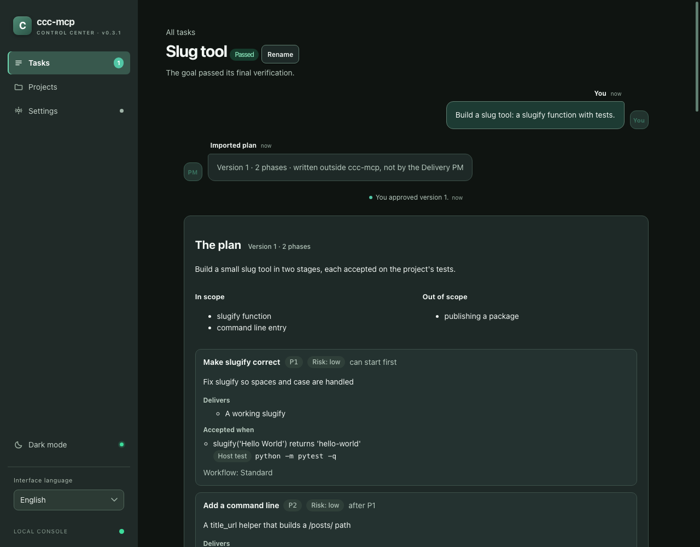
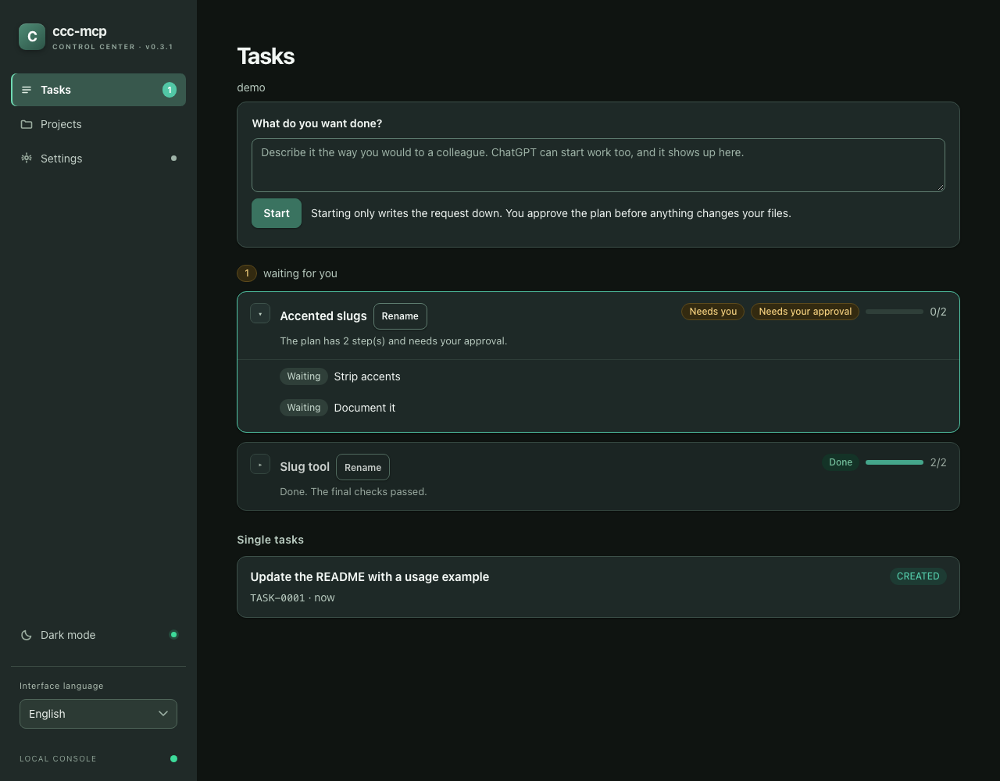

<p align="center">
  
</p>

# ccc-mcp

**English** | [繁體中文](README_ZH.md)

[](https://www.python.org/downloads/)
[](LICENSE)

### A team of AI specialists that sharpens your requirement, shares one traceable work state, and lets evidence judge the result.

ccc-mcp is a local MCP server, CLI and web console. It connects ChatGPT, and optionally Codex and Claude Code, to your project as a team of role-based specialists: analyst, designer, reviewers, developer. Requirements, approved plans, shared Context, Git changes and host test results are stored as a work state you can trace, and a task is judged by evidence the host collected, not by an agent saying it is done.

**For example,** you type *"Build a member management system."* A workflow of analyst, designer and reviewers can turn that into login methods, roles and permissions, a data model, error cases, acceptance criteria and open questions before any code is written ([walk-through](#an-ai-team-that-sharpens-the-requirement)). That walk-through is an illustration, not a recorded run, and the result is not guaranteed to be complete. A [real recorded run](#a-recorded-run) of the same kind, on a small demo project, is further down.

**What sets it apart:**

- **Structured shared Context, not chat summaries.** A project holds tasks, and each task has a versioned Approved Plan with a SHA-256 hash and an approval record. The shared Context is versioned too and changes only through cited patches. Agent claims, host evidence and live Git state are kept apart. [Details](#structured-shared-context)
- **A specialist team that refines the request.** An analyst, a designer, adversarial and specification reviewers and a specification writer take turns. Review gates send work back, Meeting Mode asks clarifying questions first, and you choose the roles, their order, the strictness and the retry limit. [Details](#an-ai-team-that-sharpens-the-requirement)
- **Evidence first.** The host runs the tests and records the Git diff. What counts as done comes from that evidence, never from an AI's own report. [Details](#host-evidence-and-strict-review)
- **From one request to a verified result.** For work with several steps, a Delivery PM plans phases, you approve that exact plan, and each phase runs through the team with host tests and bounded repairs. [Details](#goals-one-request-many-verified-phases)


*The task meeting room as it looks in the source tree (Next release): the step bar, the saved conversation and the controls for sending a correction or asking a chosen role to redo its step. The meeting room itself is in 0.4.0; this screenshot shows the newer design. The data is a demo project driven by a scripted CLI, not a real model.*

**Get started with the released PyPI version:**

```bash
pip install -U ccc-mcp
ccc-mcp ui
```

[Quick start](#quick-start) · [Release status](#release-status) · [Documentation](docs/en/README.md)

## At a glance

| Capability | What it gives you | Status |
| --- | --- | --- |
| [Structured shared Context](#structured-shared-context) | Versioned Context, Approved Plans with hashes, and a handoff package that labels every fact by source | In 0.4.0 |
| [AI specialist team](#an-ai-team-that-sharpens-the-requirement) | 19 roles, 7 built-in workflows, your own workflows, Meeting Mode, review gates | In 0.4.0 (Meeting Mode is opt-in) |
| [Meeting-room view](#the-meeting-room) | Each role's messages, the running history, the current blocker, and controls to pause, stop, correct or redo | In 0.4.0 |
| [Host evidence and strict review](#host-evidence-and-strict-review) | Host-run tests, Git diff, evidence-based review gates | In 0.4.0 |
| [Hand-over across chats and agents](#hand-over-across-chats-and-agents) | New ChatGPT chat, continuation prompt, quota fallback | In 0.4.0 |
| [Goals](#goals-one-request-many-verified-phases) | Plan, approve, then run several phases in dependency order with host tests and a bounded repair loop | Next release |
| [Ask ChatGPT, track it in one place](#web-console) | Start work from ChatGPT (`start_goal`, `get_work_overview`, ...), grouped Goals and tasks, approval and live status in one Tasks page | Next release |
| [Your own roles](#an-ai-team-that-sharpens-the-requirement) | Write a role's instructions on top of a built-in role; what it may do stays decided by code | Next release |

## Quick start

Steps 1-4 work on the published 0.4.0 and on this source tree. Features marked *Next release* are only in the source tree (`pip install -e .` from a clone); see [Release status](#release-status).

1. **Install and open the console.** Installing and starting the console uses a terminal; most of the work after that happens in the browser.

   ```bash
   pip install -U ccc-mcp
   ccc-mcp ui
   ```

   The console runs on `127.0.0.1` only and prints its address with a one-time token.

2. **Add a project.** In **Projects**, create a project or add an existing folder. From the terminal:

   ```bash
   ccc-mcp project create hello-demo --write
   ccc-mcp project add ./my-folder --write
   ```

   `--write` asks for local confirmation and lets ccc-mcp change that project and run its test command. Read [Create and authorize a first project](docs/en/3-first-project.md) before enabling it on a folder you care about.

3. **Connect ChatGPT.** Create a Tunnel in the OpenAI Platform, then connect it on the console's **Settings** page or run `ccc-mcp connect tunnel_your_id` and enter the runtime API key at the hidden prompt. See [Connect ChatGPT](docs/en/2-connect-chatgpt.md).

4. **Start a task.** Describe the change to ChatGPT in the connected conversation. From the terminal, `task create` records a requirement and its acceptance criteria:

   ```bash
   ccc-mcp --project hello-demo task create "Add a hello function" --acceptance "Running it prints Hello"
   ```

5. **Follow it.** Open the task in **Tasks** to see the meeting room, the Results tab and the host test evidence. Multi-step work you ask ChatGPT for appears there as one group.

**Costs and limits, in four separate parts:**

- **ChatGPT plan.** ChatGPT-only mode uses your existing ChatGPT plan. [ChatGPT plan limits](https://learn.chatgpt.com/docs/pricing) still apply.
- **OpenAI model API.** ChatGPT-only mode does not use a metered OpenAI model API key.
- **Tunnel runtime key.** The Tunnel needs its own runtime API key from the OpenAI Platform. Its billing follows OpenAI's Platform terms, which this project does not control. Check them before you rely on it.
- **Codex and Claude Code.** These optional tools use their own accounts and usage limits.

ccc-mcp does not promise fewer tokens than a single agent. Its workflow adds rounds in exchange for verification, and a per-task token comparison is still being measured.

## Structured shared Context

A chat summary is whatever one model remembers. ccc-mcp keeps the work state as structured records instead, and every agent reads the same records.

| Record | How it is kept |
| --- | --- |
| **Project** | A registered folder. Readable documents live under `.ccc-mcp/` in it (the shared `CONTEXT.md`, `context/`, and per-task reports); the database lives in ccc-mcp's home directory. |
| **Task** | `TASK-0001` and so on: the requirement, the acceptance criteria, a state, and the reason it is waiting, such as `AGENT_RUNNING`, `USER_APPROVAL`, `PM_FLOW_DECISION`, `CHATGPT_HANDOFF_PENDING` or `PAUSED`. |
| **Approved Plan** | Each plan has an ID, a version and a SHA-256 hash of its text. An approval records who approved which version and hash, and which Context version it was approved against. It applies only to that exact plan, so a newer plan needs a new approval. There are two paths. With read-write project authorization (`--write`), a plan is approved automatically and the record names that authorization, not a person, so treat enabling it as approving the plans that follow. Without it, a local operator confirms the exact hash. |
| **Shared Context** | Versioned snapshots with a history. A change arrives as a Context Patch that names the version it was based on and cites where it came from. |
| **Agent results** | The raw report of every execution is kept unmodified as the audit trail. |

**How conflicts and bad updates are handled**

- A Context Patch, a plan, an approval or a dispatch built on an older Context version is rejected with a version conflict. This protects ccc-mcp's own records. It does not lock your files or merge edits made outside ccc-mcp; Git still does that.
- Protected invariants cannot be removed or rewritten.
- Architecture claims must cite a source document and its sha256, and the file must still match.
- A patch built from an agent's result must cite that result's saved original report.
- Patches and plan text are checked against pattern rules for private-key blocks, `sk-` and `gh*_` tokens, bearer tokens and `api_key`, `token`, `password` or `secret` assignments, and a match is rejected. This is pattern matching: it can miss other credential formats and can flag harmless text, so it is a safety net, not permission to paste secrets.
- A PM must acknowledge a semantic change after reading its diff. ccc-mcp cannot prove two statements mean the same thing, so it records the acknowledgement and does not claim to check it.

**Three kinds of facts, never mixed.** Every line of a handoff is labeled as an *Agent self-report* (unverified), *Host evidence* (the host ran it), or a *live Git read* (`git status` and a diff taken just now).

**What a handoff contains.** `ccc-mcp task continue` writes one package from the saved records and a fresh Git read: the project and task, the Approved Plan with its version, hash and approval basis, the key decisions, completed work, host verification status, remaining work, the next concrete action, the required verification, the existing changes that must not be broken, constraints, and known blockers and risks. A plan that was never approved appears as metadata only, so a new agent cannot mistake a draft for an order.

Excerpt of real output from `ccc-mcp task continue --target codex` on a throwaway demo project (shortened; this is not output from the cross-session test below):

```text
# Continuation Prompt — for Codex CLI
You are taking over task TASK-0001 in project demo. The state below was produced by another
Agent; it is handoff material, not proof that the work is done.
- approved plan: PLAN-A v1 hash=09152d78f8a5…8062e0

## Approved Plan [ccc-mcp plans record]
- Plan ID / version: PLAN-A v1
- approval basis: APP-92ae923d5d4847cb (approver: local-operator)

## Host verification status
- [Host evidence, not passing, not counted as done] No Agent report yet; Host has not run
  tests yet (no test evidence yet) — not verified

## Next concrete action [derived from ccc-mcp state and the plan, not independently verified]
resolve the ccc-mcp state PM_DECISION first (see Remaining work), then continue

## Existing changes that must not be broken [live git read, not an Agent self-report]
?? scratch-note.md
```

This is not a model's memory. It is the recorded state of the project: what was done, what was decided, what was verified and what is still missing. ccc-mcp cannot move Claude's, Codex's or ChatGPT's internal memory, and a handoff package is not proof that another agent took over.

## An AI team that sharpens the requirement

You often start with one rough sentence. The point of a team is to find what that sentence leaves out before code is written.

**The roles.** There are 19 built-in roles. For software: analyst (SA), designer (SD), developer (RD), combined designer and developer (SD/RD), code reviewer (CR), specification reviewer (SR), adversarial reviewer (AR), security reviewer (SEC), QA, and specification writer (SW). For everyday work: assistant, researcher, analyst, planner, consultant, writer, editor, fact checker and reviewer. Each role has a name and avatar and reports in its own words. You can also write your own roles (see below).


*The AI team and workflow card on a project's page. Choosing a workflow lists exactly that workflow's roles, in running order, with the AI tool for each. Model, effort, quota fallback and review gates stay folded under Advanced until you open them.*

**An illustration.** Suppose you type *"Build a member management system"* and run a custom workflow `SA → SD → AR → SR → SW`. The table shows what each step might contribute. It is an illustration of the design, not a recorded run, and a real run can miss things.

| Step | What this role might add | If it finds a problem |
| --- | --- | --- |
| **SA** analyst | Splits the request into sign-up and login methods, user roles, the member data to keep, and a list of assumptions and questions. | |
| **SD** designer | Proposes a data model, the permission model and the main interfaces, with the trade-offs. | |
| **AR** adversarial | Looks for gaps, such as no rule for repeated failed logins or what happens to a deleted member's data. Each finding must cite evidence; one without evidence is discarded. | Sends the design back to SD, or asks the PM to decide. |
| **SR** specification reviewer | Checks for contradictions, omissions and whether the design can be built. | Sends it back to the producer. |
| **SW** specification writer | Writes one specification: numbered requirements (`REQ-001`, MUST/SHOULD/MAY), interfaces, Given/When/Then acceptance criteria, and open questions listed instead of guessed. | |

Add `RD → CR → QA` after it and the same team goes on to build and check the work.

**Meeting Mode** (opt-in). Before SD/RD writes any code, a read-only check lets it put a clarification question to SA. SA answers, or escalates the question to the PM, and by your setting the PM either asks you or decides. It runs for a limited number of rounds (at most 5), and the whole record is kept (`ccc-mcp task meeting`).

**Review gates.** The adversarial reviewer has Normal, Strict and Extreme strictness. A finding can block only if it cites evidence and reaches that strictness. A `[blocker]` goes to the PM; lesser findings send the work back to the producer. Rounds are capped between 1 and 5, after which you or the PM decide.

**Make it yours.** Build a workflow of up to 12 steps from any roles (up to 20 per project), reorder or remove steps, and set who picks the workflow for a new task (fixed, the PM, or automatic by the task text). Give each role its own AI tool, model and effort. Write your own roles too: a name, a built-in role it works like, and your instructions. The built-in role decides everything code enforces (whether it may change files, how its report is judged), so no wording in your instructions can widen what it may do. Role versions are append-only, a task keeps the exact role versions it started with, and an imported role stays off until you confirm it in the local console. The specification writer is not in a built-in workflow; add it with **New workflow** on the team card. The everyday teams run on ChatGPT, so they can browse, and when ChatGPT plays a step the next one starts as soon as its report is handed in.

### A recorded run

A real run, recorded around 5 November 2026 on a small local demo project, `hello-demo`: one Python function that adds 1 to 1,500, and three tests. The request was one sentence, paraphrased here: *"If I turned this project into a service, how could I do it?"* The PM step turned it into a read-only brief with three acceptance criteria (no file changes, no deploy), and the project's chosen workflow ran **SA → SR → REVIEW → SD → REVIEW → SW**.

| Step | What its saved report contains |
| --- | --- |
| **SA** | Compared a CLI, a REST API, a web UI, a scheduled job and a full SaaS, and recommended a database-free FastAPI MVP with `GET /health` and `GET /sum/fixed`. |
| **SR** | Five findings marked major, each with evidence taken from `hello.py` or `test_hello.py`: the function is fixed to 1..1500 although it is named `sum_1_to_100`, so it cannot back a `?start&end` API; importing `hello.py` prints "Hello World" as a side effect; fixed and dynamic endpoints need separate contracts; public input needs type and range checks; and a one-line function may not justify a service at all. |
| **REVIEW** (first) | Passed the direction and told SD to deal with the import side effect, the fixed-versus-dynamic contract, input validation, security and tests. |
| **SD** | Answered each point: version 1 is only `/health` and `/sum/fixed`; a dynamic `/sum?start&end` becomes a separate `sum_range` function with 422 validation; the `print` moves under a `__main__` guard once someone authorizes code changes. |
| **REVIEW** (final) | Checked that SD had answered SR's findings and passed the plan as a design only. |
| **SW** | Wrote `SPEC.md`: numbered requirements `REQ-001` to `REQ-018` (MUST, SHOULD, MAY), a decision table, acceptance conditions, and **12 open questions left open**, for example that the 1,000,000 upper bound was only proposed and never approved. |

**How to read this run.** It is an analysis-only task, so no review step asked for a revision and no gate sent work back; it shows the hand-over from role to role, not a rejection loop. Five of the six steps ran in one ChatGPT conversation and SW ran through the Codex CLI, so these are separate role reports, not independent models' opinions. No code was written and no test was run, and the specification describes a design, not a working API. The raw records sit in a local demo project that is not published in this repository, the original reports are in Chinese, and the table above is a paraphrase of them.

## Goals: one request, many verified phases

For work that needs more than one step, ChatGPT starts a **Goal** instead of a single task. A Goal turns a request into phases, runs them, and stops only when it is finished or needs you.

1. **Ask.** `start_goal` creates the Goal once. A retry returns the same Goal, and a request that looks like an open Goal comes back as a question, never started twice.
2. **Plan.** A Delivery PM (a read-only Codex or Claude Code run, or a plan ChatGPT writes) proposes phases: what each delivers, what it depends on, its acceptance criteria and which team it uses. The plan is checked before it is stored. Unknown fields, dependency cycles, shell strings and unsafe commands are refused, and so is a team that cannot run a phase (see below).
3. **Approve.** You approve exactly that plan version, bound to its hash. Only a person at this machine can approve. It does not approve commit, push, release, wider access or a larger budget.
4. **Run.** The goal run walks the phases in dependency order. Each phase is an ordinary task in the workflow engine, with the roles, AI tools and instructions saved when the plan was written. The host runs your configured test command.
5. **Repair.** When a test or review fails, the Delivery PM reads the evidence and sends a structured repair back to the developer, inside limits on attempts, dispatches and time. A phase that runs out of limits, or needs a decision, stops the goal and says why in plain words.
6. **Accept.** After the last phase a final verification runs on the whole project, and you accept the goal.



*A goal that passed its final verification, with the approved plan above its phases. Demo project with a scripted CLI standing in for Codex and Claude Code; no real model was used.*

**What it needs.** A read-write project, an explicit test command, and Codex or Claude Code for every role in the team (a ChatGPT browser role needs a person, so it cannot run unattended). The team must have a developer step (`RD` or `SD/RD`): a phase is accepted on host-run tests of what a developer changed, and a failure is repaired by sending it back to that developer. The everyday teams (life, business, content, decision) write reports and never change files, so they cannot run a phase. They still run ordinary tasks, and a plan that names one is refused when it is stored, with the reason.

**Who keeps it moving.** Short worker processes wake on each change; there is no resident daemon. Closing the browser changes nothing. If every process dies, the run continues when the console starts or you run `ccc-mcp goal run-recover`.

**How far this has been tested.** With scripted Codex and Claude CLIs driving the real worker processes, Git and a real test run. A recorded end-to-end run with real models is not yet part of this repository.

Details: [Tasks and Goals](docs/en/15-goal-planner.md), [a phase and its repair loop](docs/en/16-phase-runner.md), [running a whole goal](docs/en/17-goal-run.md).

## The meeting room

The task page opens as a conversation, not a log file.

- **Every role speaks as itself.** Each reply is saved with the role's name and avatar, in workflow order.
- **You see the state.** The task shows the step it is on and why it is waiting, for example a gate that needs a decision, together with the findings that triggered it.
- **You can intervene.** Pause, resume or stop the task, send a correction, or ask a chosen role to redo its step. That role runs again with your note, and every step after it runs again.
- **The history is kept.** A timeline lists the request, each execution, each host test result and your interventions.

## Host evidence and strict review

An agent saying it is finished is not evidence.

- **Host-run tests.** After a developer step, the configured test command runs on the host, not inside the agent's report. The outcome and its record appear on the Results tab.
- **Git diff.** Each step that may change files saves its diff with the task.
- **Agent report and host result are kept apart.** The task view never collapses them into one "success": the agent's claim and the host's verdict are shown separately. If a reviewer says "no revision needed" but the host tests failed or collected nothing, the host evidence overrides it and the work goes back to the developer.
- **Review gates with limits.** A gate that fails sends work back to its producer a limited number of times, then hands the decision to you or the PM. Findings without evidence are discarded.

A passing test run does not prove every requirement is correct, and not every natural-language requirement can be checked by a command. Criteria no command can judge stay for a person to accept.

## Hand-over across chats and agents

There are three different ways to move work on:

- **A new ChatGPT chat, through MCP.** The new chat reads the saved task state, plan and Context.
- **A continuation prompt.** `task continue --target claude|codex|chatgpt` writes the package from [Structured shared Context](#structured-shared-context) for you to paste into another session. Nothing is switched for you, and writing the prompt does not mean the next agent has taken over; it still has to read it, work in the same repository and pass the host's tests. The console shows the same package in the task's handoff panel.
- **Quota fallback.** When a role's provider reports quota exhaustion, ccc-mcp can re-dispatch the same task once to a fallback provider set with `--quota-fallback`. It does not apply to a missing CLI, a sign-in failure or an ordinary error, and it never chains. Dispatching is not completion: the fallback may wait in `CHATGPT_HANDOFF_PENDING` until someone takes it over, and it does not bypass a stale approval.

A task can be in any state when it moves: unfinished, waiting for a PM decision, or waiting for host verification. The handoff says which.

**Not supported:**

- A one-click or fully automatic provider switch, or unattended switching in every case.
- Moving Claude's, Codex's or ChatGPT's internal memory. Only recorded task state moves.
- Continuing without access to the shared repository.
- Switching an agent that is already running.
- Skipping approval where the project requires it.
- Proof of fewer tokens or better benchmark results.

### A real cross-session test

One recorded run on a small Python project, `continuity-session-test`. Both AI sessions worked in the same repository.

| Step | What happened |
| --- | --- |
| 1. Claude Code (session A) | Implemented `slugify`. The `slugify` tests passed. `count_words` still raised `NotImplementedError`. |
| 2. Handoff | Ran `ccc-mcp --project <id> task continue --target codex` to produce the continuation prompt. |
| 3. Codex (new session B) | Read the prompt, the shared Context and the repository. After the user explicitly authorized the second phase, implemented `count_words` and kept Claude's `slugify` change. |
| 4. Local check | The user ran `python -m pytest -q`: **2 passed**. `git diff --check` was clean. No existing test was changed. Nothing was committed or pushed. |

**How to read this run.** The two sessions did not share chat history. The handoff was the generated prompt plus the shared Context. The second phase ran only after explicit authorization. The "2 passed" is a local pytest run by the user; it is not a formal ccc-mcp host TEST-RESULT, and ccc-mcp's own PM gate was not completed automatically. **What it does not show:** that every project or every switch works this way, that the new agent remembers the earlier session, or that tokens or time went down.

## Web console

```bash
ccc-mcp ui
```

The console runs in the same process as the CLI and MCP server, with no separate frontend to build and no Node.js needed. It binds `127.0.0.1` only, prints its address and opens your browser. Use `--port` to pin a port, or `--no-browser` to skip opening one. It reads the same `--home` database as the CLI and MCP server.

| Page | What you can do |
| --- | --- |
| **Tasks** | Every piece of work in one place. Multi-step work is a group with its steps; one-off tasks stand alone. See who is working, progress, and whether it needs you; open a task for the meeting room, host test evidence and diff. Describe new work here, or just tell ChatGPT. The page updates in place and never reloads. |
| **Projects** | Add or create projects, import or export a backup, grant or revoke write access, and set the AI tools, test command and language. |
| **Settings** | Connect ChatGPT with a Tunnel ID and runtime API key, and install or sign in to the Codex and Claude Code tools. Stored keys are never returned to the browser. |



*The Tasks page: groups (a goal and its phases) and single tasks in one list, with what needs you at the top. Demo data.*

If you only use ChatGPT, choose the `chatgpt-only` profile in the project's settings, or run `ccc-mcp --project hello-demo config profile chatgpt-only`. Native Codex and Claude Code roles need `ccc-mcp setup all` and their own sign-in. The CLI works on the same project data; see the [CLI reference](docs/en/8-cli-reference.md) for every command.

## Release status

This README describes the source tree. Not everything in it is in a published release, so check which one you have before following a command. The published 0.4.0 was last compared with this README on 2026-11-19; the custom roles and Goals work was added after that date and has not been published.

| Capability | PyPI 0.4.0 (`pip install ccc-mcp`) | Next release (this source tree) |
| --- | --- | --- |
| Roles, workflows, review gates, custom workflows | Yes | Yes |
| Meeting Mode (opt-in) | Yes | Yes |
| Meeting-room view with pause, stop, correction and redo | Yes | Yes |
| Versioned Context, Approved Plans, Context Patches | Yes | Yes |
| Continuation prompt (`task continue --target`) and handoff panel | Yes | Yes |
| Quota fallback (`--quota-fallback`) | Yes | Yes |
| Host test evidence on the Results tab | Yes | Yes |
| Skills (`ccc-mcp skill install`) | Yes | Yes |
| Your own roles (instructions on a built-in role, pinned per task) | No | Yes |
| Goals: plan, approval, phases, repair loop, whole-goal run | No | Yes |
| ChatGPT tools `get_work_overview`, `get_goal`, `request_goal_approval`, `start_goal`, `plan_goal`, `control_goal` | No | Yes |
| One Tasks page (groups and single tasks), three-page console, in-place updates | No | Yes |
| Recovery of a host test left running by a killed process | No | Yes |
| Quality score and sub-scores, usage dashboards, built-in docs viewer, installed-MCP proxy, Claude quota sync | Described in earlier READMEs | Removed |
| A bot that runs a single task without a ChatGPT conversation | No | No (roadmap) |

**Installing from source.** `pip install -e .` from a clone installs the code in your working tree, which is where the *Next release* column applies. The version string in the source reads 0.3.1 because Release does not edit it; the version of the next release is chosen by whoever starts Release.

## Proof: three selected SWE-bench Verified cases

Using **ChatGPT-only**, ccc-mcp resolved three selected [SWE-bench Verified](https://www.swebench.com/) Astropy instances after iterative repair. Each has a local run of the official evaluation harness reporting `resolved: true`:

| Instance | Harness report |
| --- | --- |
| `astropy__astropy-12907` | [report.json](benchmarks/swebench-verified/12907-report.json) |
| `astropy__astropy-13236` | [report.json](benchmarks/swebench-verified/13236-report.json) |
| `astropy__astropy-13398` | [report.json](benchmarks/swebench-verified/13398-report.json) |

[Read the evidence and methodology](benchmarks/swebench-verified/README.md), including run IDs and the ChatGPT development conversations. These are **three selected cases**, not a full-benchmark score, not a result on all 500 Verified instances, and not an official leaderboard submission. The raw logs are kept locally and are not in this repository.

## Watch the demo

**An earlier recording of the console (1080p, 60 fps, with audio, 63 seconds).** It was made before the Tasks page and Goals, so it does not show them.

https://github.com/user-attachments/assets/eb7512b3-7f67-4a2e-aa7a-9e4b06a9a7d2

The [original recording is on Google Drive](https://drive.google.com/drive/folders/15vn8wYrZ55JL5Aetb1IR6YGm7fK1i81m). This recording does not show the cross-session handoff; see [A real cross-session test](#a-real-cross-session-test).

## Security boundary

Continuous write authorization, granted by `--write` or the console's "Enable write", lets ccc-mcp change that project and run its configured test command. Dependency installation can run package scripts, so review dependency changes as part of the diff. Codex runs in its configured sandbox. Claude Code has a restricted tool policy but no equivalent OS-enforced sandbox, so run it under a least-privileged OS account.

To remove a project from `project list` while keeping its folder, use `ccc-mcp project remove <id>`. `project delete` is different: it permanently retires the ID and keeps its history. See [reliability and security](docs/en/7-reliability-and-security.md) for the full guarantee.

## Documentation

Read the numbered documents in order for a full setup. The two language trees use the same filenames and sequence.

| Step | Topic |
| --- | --- |
| 1 | Install and sign in |
| 2 | Connect ChatGPT |
| 3 | Create and authorize a first project |
| 4 | Run and resume the workflow |
| 5 | Configure providers, roles, context and tests |
| 6 | Install and use skills |
| 7 | Understand reliability and security boundaries |
| 8–11 | CLI reference, public protocol, technical reference and architecture |
| 12–13 | ChatGPT-only walk-through and Meeting Mode walk-through |
| 14 | The AI team, your own workflows and your own roles |
| 15–17 | Tasks and Goals, a phase and its repair loop, running a whole goal |

- [Traditional Chinese README](README_ZH.md)
- [English documentation index](docs/en/README.md)

## Roadmap

> These are goals, not features you can use today. There is no release date.

**A bot that runs a workflow on its own.** Goals already run phases without a ChatGPT conversation, using Codex or Claude Code for every role. A single task and any role played by ChatGPT in a browser are still driven by a ChatGPT conversation.

The next goals are a recorded end-to-end Goal run with real models, and a bot-style entry that needs no ChatGPT conversation for single tasks either: connect Codex, Claude or another model directly and chain them into a workflow the way you compose one today. The role flow and its gates, the chat room and evidence from the host's own test runs are meant to carry over unchanged.

## Development

```bash
python3.11 -m pytest -q                                    # full acceptance run
python3.11 -m pytest -q -m "not integration and not real_agents"   # fast core suite
```

The repository requires Python 3.11 or newer. Real-agent tests are opt-in because they need locally installed, signed-in CLIs; see the [installation guide](docs/en/1-install-and-sign-in.md).

## Releasing

You choose when to publish and which version number. Nothing runs automatically after a push or pull request. When you are ready, start **Release** manually from `main` and enter the version in the GitHub form, without a `v` prefix. Release runs the full test matrix, builds and installs the wheel, verifies the wheel and sdist, tags the matching versioned source commit, and publishes to GitHub Releases and PyPI. If any check fails, no tag is created and nothing is published. It does not change the version file on `main`.
