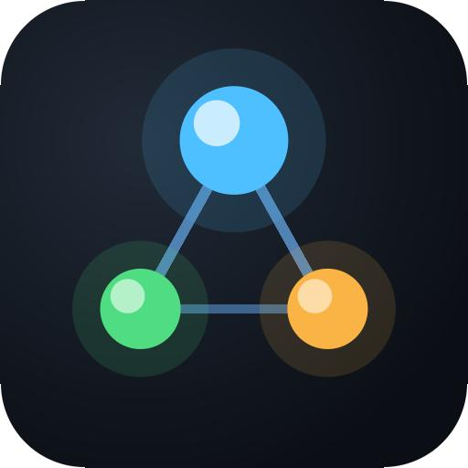

<p align="center">
  
</p>

# ccc-mcp

**Let ChatGPT Chat write, test, and review code on your own computer.**

[](https://github.com/bruce601080102/ccc-mcp/actions/workflows/release.yaml)
[](https://www.python.org/downloads/)
[](docs/en/1-install-and-sign-in.md)
[](https://modelcontextprotocol.io/)
[](LICENSE)

[](docs/en/2-connect-chatgpt.md)
[](docs/en/4-workflow.md)
[](docs/en/4-workflow.md)

ccc-mcp connects ChatGPT Chat to a local coding workspace through MCP, so it can work on an **authorized repository**. Its core idea: **don't take an AI's word that the code works — keep local evidence.** Tests are run by the host, not reported by the agent; every diff, test result and review is saved and resumable, which a chat window can't do on its own. As a bonus, it runs on your existing ChatGPT plan, with no separately metered model API to set up. **ChatGPT-only is the primary workflow.** Codex and Claude Code are optional providers for teams that want to split roles across tools.

> [繁體中文 README](README_ZH.md) · [English documentation](docs/en/1-install-and-sign-in.md)

## Watch the demo

**1080p · 60 fps · with audio.** The inline demo is split into three HD chapters to fit GitHub's video attachment limit. The uninterrupted [56-second HD video is also available to watch or download](docs/assets/demo.mp4).

**ChatGPT works on Astropy and shows the test result (0:40–0:56)**

https://github.com/user-attachments/assets/cf288955-585b-43bb-9a0b-275194ac13c4

<details>
<summary>Start from the beginning: UI and projects (0:00–0:20)</summary>

https://github.com/user-attachments/assets/86165f18-3e9c-4ed0-8010-766f263f933b

</details>

<details>
<summary>Tasks, settings, and Skills & MCP (0:20–0:40)</summary>

https://github.com/user-attachments/assets/36ea8738-c4c9-4562-b2f2-38b18838e6d7

</details>

The [original recording is on Google Drive](https://drive.google.com/drive/folders/15vn8wYrZ55JL5Aetb1IR6YGm7fK1i81m). The separate [SWE-bench evidence](#proof-three-selected-swe-bench-verified-cases) records the official harness results.

Want to try it yourself? The quick start below takes you from `ccc-mcp ui` to a ChatGPT conversation connected to an authorized local project.

## Start with the UI

Install ccc-mcp, then open its local control center:

```bash
pip install ccc-mcp
ccc-mcp ui
```

Requires Git and Python 3.11+. In the UI:

1. **Projects:** create a project or add an existing folder, then enable write access for the project.
2. **Connect:** follow [Connect ChatGPT](docs/en/2-connect-chatgpt.md) to create an OpenAI Platform Tunnel. Enter its Tunnel ID and runtime API key in the console.
3. **Settings:** select the `chatgpt-only` profile. The **Test command** can be left blank: ccc-mcp installs declared Python dependencies and chooses tests from changed test files when possible. Set a command when you need a specific scope.
4. **ChatGPT:** select the ccc-mcp connection and ask it to make a change. Inspect **Tasks** and **Context** in the UI to see the actual edits, test results, and next step.

The UI runs on local `127.0.0.1` and stops with Ctrl+C. [See every console page](#web-console).

**About tokens and keys:** This workflow uses your existing ChatGPT plan instead of an OpenAI *model* API key and its per-token API billing. [ChatGPT plan limits](https://learn.chatgpt.com/docs/pricing) still apply. ccc-mcp does not claim to use fewer tokens than a single agent: the `SA → SD/RD → REVIEW` workflow adds rounds in exchange for verification, and a per-task token comparison is still being measured. The Tunnel connection uses its own runtime API key; [connection setup](docs/en/2-connect-chatgpt.md) explains that key.

## What makes ccc-mcp useful

| Capability | What you get |
| --- | --- |
| **Evidence, not self-reports** | The host installs declared dependencies and runs pytest itself; an agent saying “tests pass” never counts. Host-observed results, exit codes when available, diffs, reports and review evidence are kept for every round. |
| **ChatGPT Chat as the coding agent** | ChatGPT can read and edit an authorized local project, then continue the work in the same conversation. No Codex or Claude Code installation is required for `chatgpt-only`. |
| **A recoverable workflow** | Run `SA → SD/RD → REVIEW` with versioned shared Context and saved execution records. Resume a task in another chat from the project’s `.ccc-mcp` data. |
| **Task conversation and controls** | Read each task as an evidence-backed conversation. Pause, resume, stop, or leave a correction from the local UI; saved handoffs keep ChatGPT and the next agent informed. |
| **Traceable execution evaluation** | The optional evaluation engine turns host tests, diffs, and lint findings into versioned reports. Quality scores are paired with evidence coverage; missing signals are never silently treated as perfect. Evaluate and inspect results from the task page. |
| **Skills, including MCP-oriented Skills** | Install reusable `SKILL.md` guidance, including nested supporting files. Choose global Skills in the UI so every project and role can use them. A Skill can guide an agent to use an MCP tool after that server is installed. |
| **MCP servers and tools** | Discover local MCP servers, install one for a project, select which tools the project may use, and call them from ChatGPT. For example, `codebase-memory-mcp` can provide repository structure and code relationships. Skills guide the workflow; MCP tools supply live capabilities. |
| **One local control center** | Manage projects, permissions, connections, global Skills, per-project MCP tools, tasks, and Context from `ccc-mcp ui`. The CLI remains available for scripts and advanced use. |

## How execution evaluation works

The evaluation engine (opt-in, off by default) scores a completed SA/SD/RD/REVIEW execution from evidence that is already saved — the host-run test result, the execution's diff, and `ruff` static analysis — **with no additional LLM call and no extra token cost**. It never asks an Agent whether its own work passed, and never treats one Agent's agreement with another as proof of correctness.

Two numbers are reported separately, on purpose:

- **`quality_score`** is the weighted average of only the sub-scores that actually have evidence behind them, using the role's configured weights (test/requirement/code-quality/security/review — editable per role, with one-click presets, in the web console's settings page).
- **`evidence_coverage`** is the share of that role's weight budget those sub-scores actually cover. A `quality_score` of 100 with 70% coverage means "everything we could check looked perfect, but we could only check 70% of what this role is normally judged on" — not "100% confidence."

A small set of hard rules decides `task_status` separately from the weighted score: a failing acceptance test, or a test suite that never ran, can never read as `PASSED`, no matter how high the weighted average is. A Beta-Bernoulli reputation tracker (`ccc-mcp reputation`) keeps per-agent/model/role/task-type reliability across every project, with wide, explicit uncertainty while sample sizes are small — never a confident number from too little data.

See [Technical reference](docs/en/10-technical-reference.md#evaluation-engine) for the exact formulas and data model.

## Proof: three selected SWE-bench Verified cases

Using **ChatGPT-only**, ccc-mcp resolved three selected [SWE-bench Verified](https://www.swebench.com/) Astropy instances after iterative repair. Each has a local run of the official evaluation harness reporting `resolved: true`:

| Instance | Harness report |
| --- | --- |
| `astropy__astropy-12907` | [report.json](benchmarks/swebench-verified/12907-report.json) |
| `astropy__astropy-13236` | [report.json](benchmarks/swebench-verified/13236-report.json) |
| `astropy__astropy-13398` | [report.json](benchmarks/swebench-verified/13398-report.json) |

[Read the evidence and methodology](benchmarks/swebench-verified/README.md), including run IDs and ChatGPT conversations. These are **3 selected cases**, not a full-benchmark score or an official leaderboard submission.

## ChatGPT first; other agents are optional

With the `chatgpt-only` profile selected, ChatGPT handles the project manager and `SA → SD/RD → REVIEW` roles. The workflow records each handoff so the next chat can pick up the saved state.

```text
ChatGPT Chat → local project → tests, diff, review
       ↑                            │
       └──── saved Context and next step ────┘
```

If you want a multi-agent workflow, assign supported roles to Codex or Claude Code through their native CLIs. Configure providers, effort, quota fallback, test command, and report language in **Settings**. See the [workflow guide](docs/en/4-workflow.md).

## Web console

```bash
ccc-mcp ui
```

Starts a local web console in the same process that already serves the CLI and MCP server — no separate frontend to clone, build, or run, and no Node.js required even if you build from source (the UI ships as plain HTML/CSS/JS bundled into the `ccc-mcp` wheel). It binds `127.0.0.1` only, prints its URL, and opens your browser; pass `--port` to pin a port (ccc-mcp reports clearly if that port is taken) or leave it out to pick a free one automatically, and `--no-browser` to skip the auto-open. Press Ctrl+C to stop it. It reads the same `--home` database the CLI and MCP server use, so projects and tasks are always in sync across all three.

The console's main pages:

| Page | What you can do |
| --- | --- |
| **Command center** | Track task activity, blockers, project load, and agent evaluation history. Filter this workspace's CLI token records from five minutes to one month; see Codex plan-window remaining percentages and reset times. Enable Claude quota sync in the UI and click Check now: ccc-mcp briefly opens Claude Code in the background (one tiny Haiku message, no terminal needed) and shows its official five-hour and seven-day remaining percentages. The page checks local data every five minutes while open. Account-wide lifetime tokens are separate and cannot be attributed to a Chat, Codex run, or ccc-mcp project. |
| **All projects** | Create projects, add existing folders, organize groups, and manage write access. |
| **Settings** | Set the profile, providers and roles, report language, test command, and Meeting Mode. |
| **Tasks / Context** | Inspect stages, waiting reasons, execution history, usage and CLI invocation evidence, raw results, and shared context. |
| **Connect** | Connect ChatGPT with an OpenAI Platform Tunnel ID and runtime API key; inspect status and logs. |
| **Global Skills** | Select local Claude Code or Codex Skills to install for every project and role; inspect or remove installed Skills. |

Claude quota sync is opt-in: open **Command center → Usage and remaining allowance → Enable Claude quota sync**. It adds a small wrapper to your Claude Code user `statusLine` setting and preserves and runs an existing status line. The usage snapshot in the local ccc-mcp home contains only reported percentages, reset times, and observation time; separate installation metadata retains the previous status-line setting for restoration. Open an interactive Claude Code session and receive one response to populate the values; Claude Code supplies these fields only after an API response. The dashboard checks the local snapshot every five minutes, labels older observations, and removes expired windows. **Disable Claude quota sync** restores the previous setting and deletes the local snapshot. This does not call Claude's model or read its login credentials. See [Anthropic's status-line field documentation](https://code.claude.com/docs/en/statusline).
| **Skills & MCP** | View shared Skills; discover, install, and manage local stdio MCP servers and their tools for one project. |
| **Documentation** | Read the bundled English and Traditional Chinese guides inside the console. |

In **Skills & MCP**, inspect tools, choose which ones this project may use, invoke enabled tools with JSON arguments, and view recent MCP calls. Globally installed MCP servers also appear there, but still require the CLI to remove. The sidebar's interface language is separate from each project's report language. **Connect** can remember a runtime API key on this device (`~/.ccc-mcp/tunnel/credentials.json`, readable only by your OS account); stored keys are never returned to the browser. Enabling write, clearing history, and deleting require typed confirmation. See [reliability and security](docs/en/7-reliability-and-security.md#web-console) for details.

On **All projects**, create named groups, move project cards with the dropdown or drag-and-drop, and reorder groups. This only changes local console organization (`<home>/ui/project_groups.json`), not project paths or settings. **Connect** can save multiple named profiles, including different keys for the same Tunnel ID; select a saved profile and click Connect to use it. One Tunnel connection runs at a time.

## CLI: automation and advanced use

If you prefer a terminal or write scripts, the CLI operates on the same project data. `ccc-mcp setup all` and signing in to Codex or Claude Code are only needed if you plan to use those **optional** native roles. For example, to create a project entirely from the CLI:

```bash
ccc-mcp project create hello-demo --write
ccc-mcp --project hello-demo task status
ccc-mcp --project hello-demo task usage
ccc-mcp --project hello-demo context show
```

`--write` asks for local confirmation while creating the project, authorizing ccc-mcp to write there and run its configured test command. For an existing folder, use `ccc-mcp project add <folder> --write`. If you only use ChatGPT, skip `setup all` and select `chatgpt-only` in the project's **Settings**, or run `ccc-mcp --project hello-demo config profile chatgpt-only`.

For native roles, `task usage` shows whether the CLI was actually invoked. ChatGPT roles are interactive: `task usage` marks them `"interactive": true` with `invocation.source: "chatgpt_web"`, so `cli_invoked: false` is expected. See the [CLI reference](docs/en/8-cli-reference.md) for all commands.

## Documentation

Read the numbered documents in order for a full setup. The two language trees use the same filenames and sequence.

| Step | Topic |
| --- | --- |
| 1 | Install and sign in |
| 2 | Connect ChatGPT |
| 3 | Create and authorize a first project |
| 4 | Run and resume the workflow |
| 5 | Configure providers, roles, context, and tests |
| 6 | Install and use skills |
| 7 | Understand reliability and security boundaries |
| 8–11 | CLI reference, public protocol, technical reference, and architecture |

- [Traditional Chinese README](README_ZH.md)
- [English documentation index](docs/en/README.md)

## Important boundary

Continuous write authorization — granted via `project authorize`, `project add --write`/`project create --write`, or the web console's "Enable write" — permits ccc-mcp to modify that project and run its configured test command. Dependency installation can execute package scripts, so review dependency changes as part of the diff. Codex runs in its configured sandbox. Claude Code has a restricted tool policy, but does **not** yet have an equivalent OS-enforced sandbox; use a least-privileged OS account for it.

To remove a project from `project list` while keeping its folder, use `ccc-mcp project remove <id>` (or the web console's **Remove, keep folder** action). This clears ccc-mcp records by default; registering the same ID again starts with empty records. Add `--delete-files` to delete the project folder too, or `--keep-records` to retain an archive of the old records. The web console offers the same **Keep records** checkbox in either removal flow. The CLI and web console require typed confirmation, and running executions must finish or be cancelled first. `project delete` is different: it permanently retires the ID and preserves historical records and files. See [reliability and security](docs/en/7-reliability-and-security.md) for the full guarantee.

## Development

```bash
python3.11 -m pytest -q
```

The repository requires Python 3.11 or newer. Real-agent tests are opt-in because they need locally installed, authenticated CLIs; see [Chinese](docs/ch/1-install-and-sign-in.md) or [English](docs/en/1-install-and-sign-in.md).
