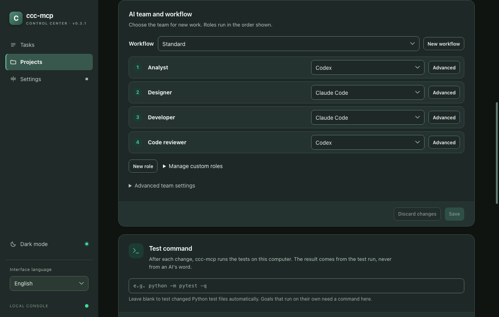
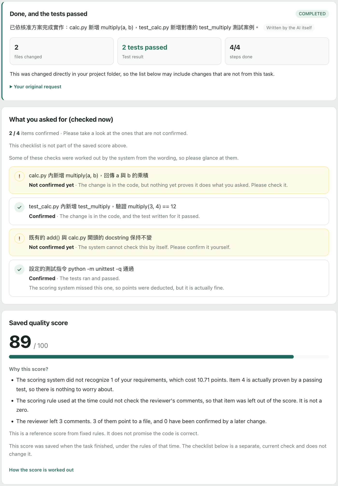

<p align="center">
  
</p>

# ccc-mcp

**English** | [繁體中文](README_ZH.md)

[](https://www.python.org/downloads/)
[](LICENSE)

### A team of AI specialists that sharpens your requirement, shares one traceable work state, and lets evidence judge the result.

ccc-mcp is a local MCP server, CLI and web console. It connects ChatGPT, and optionally Codex and Claude Code, to your project as a team of role-based specialists: analyst, designer, reviewers, developer. Requirements, approved plans, shared Context, Git changes and host test results are stored as a work state you can trace, and a task is judged by evidence the host collected, not by an agent saying it is done.

**For example,** you type *"Build a member management system."* A workflow of analyst, designer and reviewers can turn that into login methods, roles and permissions, a data model, error cases, acceptance criteria and open questions before any code is written ([walk-through](#an-ai-team-that-sharpens-the-requirement)). That walk-through is an illustration, not a recorded run, and the result is not guaranteed to be complete.

**Three things that set it apart:**

- **Structured shared Context, not chat summaries.** A project holds tasks, and each task has a versioned Approved Plan with a SHA-256 hash and an approval record. The shared Context is versioned too and changes only through cited patches. Agent claims, host evidence and live Git state are kept apart. [Details](#structured-shared-context)
- **A specialist team that refines the request.** An analyst, a designer, adversarial and specification reviewers and a specification writer take turns. Review gates send work back, Meeting Mode asks clarifying questions first, and you choose the roles, their order, the strictness and the retry limit. [Details](#an-ai-team-that-sharpens-the-requirement)
- **Evidence first, then a score.** The host runs the tests and records the Git diff and static analysis. A rule-based quality score and an evidence coverage figure are computed from that, and the Preview checklist shows which of your requirements are confirmed. The score is not an AI accuracy rate. [Details](#an-explainable-quality-score)


*The task meeting room (released feature), showing the request, the analyst's reply, and the controls for sending a correction or asking a chosen role to redo its step. The task text is Chinese because the demo task was written in Chinese.*

**Get started with the released PyPI version:**

```bash
pip install -U ccc-mcp
ccc-mcp ui
```

[Quick start](#quick-start) · [Release status](#release-status) · [Documentation](docs/en/README.md)

## At a glance

| Capability | What it gives you | Status |
| --- | --- | --- |
| [Structured shared Context](#structured-shared-context) | Versioned Context, Approved Plans with hashes, and a handoff package that labels every fact by source | Released |
| [AI specialist team](#an-ai-team-that-sharpens-the-requirement) | 19 roles, 7 built-in workflows, your own workflows, Meeting Mode, review gates | Released (Meeting Mode is opt-in) |
| [Meeting-room view](#the-meeting-room) | Each role's messages, the running history, the current blocker, and controls to pause, stop, correct or redo | Released |
| [Explainable quality score](#an-explainable-quality-score) | Rule-based score, evidence coverage, status, history and re-evaluation | Released (opt-in) |
| Requirement checklist and scorecard | Each requirement shown as Confirmed, Not met or Not confirmed yet | Preview |
| [Host evidence and strict review](#host-evidence-and-strict-review) | Host-run tests, Git diff, evidence-based review gates | Released |
| [Hand-over across chats and agents](#hand-over-across-chats-and-agents) | New ChatGPT chat, continuation prompt, quota fallback | Released |
| [Web console and your own team](#web-console) | Projects, roles, workflows, tasks, results, Context, Skills and MCP tools | Released |

## Quick start

This section describes the released PyPI version. Features marked Preview are not in it.

1. **Install and open the console.** Installing and starting the console uses a terminal; most of the work after that happens in the browser.

   ```bash
   pip install -U ccc-mcp
   ccc-mcp ui
   ```

   The console runs on `127.0.0.1` only and prints its address with a one-time token.

2. **Add a project.** In **All projects**, create a project or add an existing folder. From the terminal:

   ```bash
   ccc-mcp project create hello-demo --write
   ccc-mcp project add ./my-folder --write
   ```

   `--write` asks for local confirmation and lets ccc-mcp change that project and run its test command. Read [Create and authorize a first project](docs/en/3-first-project.md) before enabling it on a folder you care about.

3. **Connect ChatGPT.** Create a Tunnel in the OpenAI Platform, then connect it on the console's **Connect** page or run `ccc-mcp connect tunnel_your_id` and enter the runtime API key at the hidden prompt. See [Connect ChatGPT](docs/en/2-connect-chatgpt.md).

4. **Start a task.** Describe the change to ChatGPT in the connected conversation. From the terminal, `task create` records a requirement and its acceptance criteria:

   ```bash
   ccc-mcp --project hello-demo task create "Add a hello function" --acceptance "Running it prints Hello"
   ```

5. **Follow it.** Open the task in **Tasks** to see the meeting room, the Results tab and the evaluation.

**Costs and limits, in four separate parts:**

- **ChatGPT plan.** ChatGPT-only mode uses your existing ChatGPT plan. [ChatGPT plan limits](https://learn.chatgpt.com/docs/pricing) still apply.
- **OpenAI model API.** ChatGPT-only mode does not use a metered OpenAI model API key.
- **Tunnel runtime key.** The Tunnel needs its own runtime API key from the OpenAI Platform. Its billing follows OpenAI's Platform terms, which this project does not control. Check them before you rely on it.
- **Codex and Claude Code.** These optional tools use their own accounts and usage limits.

ccc-mcp does not promise fewer tokens than a single agent. Its workflow adds rounds in exchange for verification, and a per-task token comparison is still being measured.

## Structured shared Context

A chat summary is whatever one model remembers. ccc-mcp keeps the work state as structured records instead, and every agent reads the same records.

| Record | How it is kept |
| --- | --- |
| **Project** | A registered folder. Readable documents live under `.ccc-mcp/` in it (the shared `CONTEXT.md`, `context/`, and per-task reports); the database lives in ccc-mcp's home directory. |
| **Task** | `TASK-0001` and so on: the requirement, the acceptance criteria, a state, and the reason it is waiting, such as `AGENT_RUNNING`, `USER_APPROVAL`, `PM_FLOW_DECISION`, `CHATGPT_HANDOFF_PENDING` or `PAUSED`. |
| **Approved Plan** | Each plan has an ID, a version and a SHA-256 hash of its text. An approval records who approved which version and hash, and which Context version it was approved against. It applies only to that exact plan, so a newer plan needs a new approval. In a project with write access, the project authorization stands in for per-plan approval; otherwise a local operator confirms the exact hash. |
| **Shared Context** | Versioned snapshots with a history. A change arrives as a Context Patch that names the version it was based on and cites where it came from. |
| **Agent results** | The raw report of every execution is kept unmodified as the audit trail. |

**How conflicts and bad updates are handled**

- A patch or plan based on an older Context version is rejected with a version conflict.
- Protected invariants cannot be removed or rewritten.
- Architecture claims must cite a source document and its sha256, and the file must still match.
- A patch built from an agent's result must cite that result's saved original report.
- Secrets are rejected, and a PM must acknowledge a semantic change after reading its diff. ccc-mcp cannot prove two statements mean the same thing, so it records the acknowledgement and does not claim to check it.

**Three kinds of facts, never mixed.** Every line of a handoff is labeled as an *Agent self-report* (unverified), *Host evidence* (the host ran it), or a *live Git read* (`git status` and a diff taken just now).

**What a handoff contains.** `ccc-mcp task continue` writes one package from the saved records and a fresh Git read: the project and task, the Approved Plan with its version, hash and approval basis, the key decisions, completed work, host verification status, remaining work, the next concrete action, the required verification, the existing changes that must not be broken, constraints, and known blockers and risks. A plan that was never approved appears as metadata only, so a new agent cannot mistake a draft for an order.

Excerpt of real output from `ccc-mcp task continue --target codex` on a throwaway demo project (shortened; this is not output from the cross-session test below):

```text
# Continuation Prompt — for Codex CLI
You are taking over task TASK-0001 in project demo. The state below was produced by another
Agent; it is handoff material, not proof that the work is done.
- approved plan: PLAN-A v1 hash=09152d78f8a5…8062e0

## Approved Plan [ccc-mcp plans record]
- Plan ID / version: PLAN-A v1
- approval basis: APP-92ae923d5d4847cb (approver: local-operator)

## Host verification status
- [Host evidence, not passing, not counted as done] No Agent report yet; Host has not run
  tests yet (no test evidence yet) — not verified

## Next concrete action [derived from ccc-mcp state and the plan, not independently verified]
resolve the ccc-mcp state PM_DECISION first (see Remaining work), then continue

## Existing changes that must not be broken [live git read, not an Agent self-report]
?? scratch-note.md
```

This is not a model's memory. It is the recorded state of the project: what was done, what was decided, what was verified and what is still missing. ccc-mcp cannot move Claude's, Codex's or ChatGPT's internal memory, and a handoff package is not proof that another agent took over.

## An AI team that sharpens the requirement

You often start with one rough sentence. The point of a team is to find what that sentence leaves out before code is written.

**The roles.** There are 19 roles. For software: analyst (SA), designer (SD), developer (RD), combined designer and developer (SD/RD), code reviewer (CR), specification reviewer (SR), adversarial reviewer (AR), security reviewer (SEC), QA, and specification writer (SW). For everyday work: assistant, researcher, analyst, planner, consultant, writer, editor, fact checker and reviewer. Each role has a name and avatar you can change, and reports in its own words.



*The workflow settings page. The ability charts and "Team power" are **declared** settings, not measured results.*

**An illustration.** Suppose you type *"Build a member management system"* and run a custom workflow `SA → SD → AR → SR → SW`. The table shows what each step might contribute. It is an illustration of the design, not a recorded run, and a real run can miss things.

| Step | What this role might add | If it finds a problem |
| --- | --- | --- |
| **SA** analyst | Splits the request into sign-up and login methods, user roles, the member data to keep, and a list of assumptions and questions. | |
| **SD** designer | Proposes a data model, the permission model and the main interfaces, with the trade-offs. | |
| **AR** adversarial | Looks for gaps, such as no rule for repeated failed logins or what happens to a deleted member's data. Each finding must cite evidence; one without evidence is discarded. | Sends the design back to SD, or asks the PM to decide. |
| **SR** specification reviewer | Checks for contradictions, omissions and whether the design can be built. | Sends it back to the producer. |
| **SW** specification writer | Writes one specification: numbered requirements (`REQ-001`, MUST/SHOULD/MAY), interfaces, Given/When/Then acceptance criteria, and open questions listed instead of guessed. | |

Add `RD → CR → QA` after it and the same team goes on to build and check the work.

**Meeting Mode** (opt-in). Before SD/RD writes any code, a read-only check lets it put a clarification question to SA. SA answers, or escalates the question to the PM, and by your setting the PM either asks you or decides. It runs for a limited number of rounds (at most 5), and the whole record is kept (`ccc-mcp task meeting`).

**Review gates.** The adversarial reviewer has Normal, Strict and Extreme strictness. A finding can block only if it cites evidence and reaches that strictness. A `[blocker]` goes to the PM; lesser findings send the work back to the producer. Rounds are capped between 1 and 5, after which you or the PM decide.

**Make it yours.** Build a workflow of up to 12 steps from any roles (up to 20 per project), set who picks the workflow for a new task (fixed, the PM, or automatic by the task text), and give each role its own provider, model and effort. The specification writer is not in a built-in workflow yet; add it in **Settings → Workflow**. The everyday teams run on ChatGPT, so they can browse, and when ChatGPT plays a step the next one starts as soon as its report is handed in.

## The meeting room

The task page opens as a conversation, not a log file.

- **Every role speaks as itself.** Each reply is saved with the role's name and avatar, in workflow order.
- **You see the state.** The task shows the step it is on and why it is waiting, for example a gate that needs a decision, together with the findings that triggered it.
- **You can intervene.** Pause, resume or stop the task, send a correction, or ask a chosen role to redo its step. That role runs again with your note, and every step after it runs again.
- **The history is kept.** A timeline lists the request, each execution, each host test result and your interventions.

## An explainable quality score

Three different things appear in ccc-mcp. Do not read one as another.

| | What it is | Where it comes from |
| --- | --- | --- |
| **A. Ability chart** | The abilities a role is *set up* to have: research, reasoning, planning, creation, verification, risk sense, each 0 to 5. | Declared in **Settings**. Not measured, and not part of any score. |
| **B. Quality score** | A rule-based estimate of how good the evidence we have looks. | Computed from host tests, the diff, static analysis and review results. Released, opt-in. |
| **C. Requirement checklist** | How many of your requirements are confirmed by recorded evidence. | Checked against the evidence on the Results page. **Preview.** |

The quality score is not an AI accuracy rate. It does not say the code is correct.

**How the score is computed** (`config evaluation-engine on`; no extra model call):

- `quality_score` is the weighted average of only the sub-scores that have real evidence, using the role's weights, re-normalized over those. A sub-score with no evidence is *missing*, not zero and not perfect.
- `evidence_coverage` is the total weight of the sub-scores that had evidence, divided by the role's total weight. It says how much of the judgment rested on evidence.

| Sub-score | Weight (SD/RD) | How it is computed |
| --- | --- | --- |
| `test` | 0.40 | Pass rate of the host-run tests. Counted only if the round changed something; capped at 70 when the only passing tests were written by the agent itself. |
| `requirement` | 0.25 | Share of acceptance items with at least one of their words found in the saved text. This is a text match, not proof. |
| `code_quality` | 0.15 | 100 minus 10 for each `ruff` finding. |
| `security` | 0.10 | 100 with no security findings, otherwise 100 minus 50 for each. |
| `review` | 0.10 | 100, or 40 if the reviewer asked for a revision. Missing if there was no review. |

Weights differ by role (for example SA is scored 70% on `requirement` and 30% on `review`) and can be changed.

**A worked example,** computed with the real scoring code on made-up inputs, not from a recorded task. An SD/RD round has green host tests, two `ruff` findings, and half of the acceptance wording matched:

| | test | requirement | code_quality | security | review | Quality score | Evidence coverage |
| --- | --- | --- | --- | --- | --- | --- | --- |
| Tests ran | 100 | 50 | 80 | 100 | none | **82.78** | **90%** |
| Same round, tests never ran | none | 50 | 80 | 100 | none | **69.0** | **50%** |

A score can look healthy while coverage is low. The analyst is the clearest case: its `review` sub-score is never filled, so a perfect `requirement` score still gives a quality score of 100 with only 70% coverage. Read the two numbers together.

**Status is decided separately.** `PASSED`, `FAILED`, `NEEDS_VERIFICATION` or `INSUFFICIENT_EVIDENCE` come from hard rules that a high score cannot override: a failing acceptance test is `FAILED`, no host test run or no change at all is `NEEDS_VERIFICATION`, and coverage below 60% is `INSUFFICIENT_EVIDENCE`.

**Where you can see it.** The task page shows each evaluation with its score, coverage, status, the sub-scores and their weights, a version number and what triggered it. `task evaluations` lists the history and `task reevaluate` re-scores a task from the saved evidence. The released scorer covers the SA, SD, RD, SD/RD and CR roles.

**What it cannot do.** In a toy benchmark of 30 hand-written patches, host-visible tests caught broken work but could not tell wrong-but-green work from correct work (AUROC 0.67). `ccc-mcp validate-scoring` lets you test the score against ground truth on your own cases. See the [Technical reference](docs/en/10-technical-reference.md#evaluation-engine).

### The Results page (Preview)



*Preview, from the current vNext candidate build. The released PyPI version does not have this page yet.*

The Preview Results page puts the saved score beside a checklist of your requirements. Each requirement is **Confirmed** only when recorded evidence meets a rule that matches it, such as a passing test tied to it. It is **Not met** when evidence contradicts that one requirement, which does not mean the whole task failed, and **Not confirmed yet** when evidence is missing or a person must check. A text match or an agent's "done" never confirms anything.

One recorded acceptance run (TASK-0001, a local project) shows why both views exist. The host ran `python3.14 -m unittest -q` and 2 tests passed. The saved quality score was **89 out of 100**, yet **2 of 4 requirements** were confirmed. The `multiply` function is in the code but no test is tied to it yet, and the "keep unchanged" requirement needs a person. The saved score is kept as it was when the task finished, while the checklist is checked again against current records. During that run the PM steps were advanced by hand, so it was not a fully unattended workflow, and its raw records are not published in this repository.

## Host evidence and strict review

An agent saying it is finished is not evidence.

- **Host-run tests.** After a developer step, the configured test command runs on the host, not inside the agent's report. The outcome and its record appear on the Results tab.
- **Git diff.** Each step that may change files saves its diff with the task. The per-file viewer is Preview.
- **Static analysis.** `ruff` findings feed the `code_quality` and `security` sub-scores.
- **Agent report and host result are kept apart.** The task view never collapses them into one "success": the agent's claim and the host's verdict are shown separately. If a reviewer says "no revision needed" but the host tests failed or collected nothing, the host evidence overrides it and the work goes back to the developer.
- **Review gates with limits.** A gate that fails sends work back to its producer a limited number of times, then hands the decision to you or the PM. Findings without evidence are discarded.
- **Different states for different situations.** Evidence supports it (`PASSED`), evidence contradicts it (`FAILED`), there is not enough evidence (`INSUFFICIENT_EVIDENCE`), or the host has not verified it yet (`NEEDS_VERIFICATION`).

A passing test run does not prove every requirement is correct, and not every natural-language requirement can be checked automatically. Requirements without a matching check stay pending, for a person to confirm.

## Hand-over across chats and agents

There are three different ways to move work on:

- **A new ChatGPT chat, through MCP.** The new chat reads the saved task state, plan and Context.
- **A continuation prompt.** `task continue --target claude|codex|chatgpt` writes the package from [Structured shared Context](#structured-shared-context) for you to paste into another session. Nothing is switched for you, and writing the prompt does not mean the next agent has taken over; it still has to read it, work in the same repository and pass the host's tests. The console shows the same package in the task's handoff panel.
- **Quota fallback.** When a role's provider reports quota exhaustion, ccc-mcp can re-dispatch the same task once to a fallback provider set with `--quota-fallback`. It does not apply to a missing CLI, a sign-in failure or an ordinary error, and it never chains. Dispatching is not completion: the fallback may wait in `CHATGPT_HANDOFF_PENDING` until someone takes it over, and it does not bypass a stale approval.

A task can be in any state when it moves: unfinished, waiting for a PM decision, or waiting for host verification. The handoff says which.

**Not supported:**

- A one-click or fully automatic provider switch, or unattended switching in every case.
- Moving Claude's, Codex's or ChatGPT's internal memory. Only recorded task state moves.
- Continuing without access to the shared repository.
- Switching an agent that is already running.
- Skipping approval where the project requires it.
- Proof of fewer tokens or better benchmark results.

### A real cross-session test

One recorded run on a small Python project, `continuity-session-test`. Both AI sessions worked in the same repository.

| Step | What happened |
| --- | --- |
| 1. Claude Code (session A) | Implemented `slugify`. The `slugify` tests passed. `count_words` still raised `NotImplementedError`. |
| 2. Handoff | Ran `ccc-mcp --project <id> task continue --target codex` to produce the continuation prompt. |
| 3. Codex (new session B) | Read the prompt, the shared Context and the repository. After the user explicitly authorized the second phase, implemented `count_words` and kept Claude's `slugify` change. |
| 4. Local check | The user ran `python -m pytest -q`: **2 passed**. `git diff --check` was clean. No existing test was changed. Nothing was committed or pushed. |

**How to read this run.** The two sessions did not share chat history. The handoff was the generated prompt plus the shared Context. The second phase ran only after explicit authorization. The "2 passed" is a local pytest run by the user; it is not a formal ccc-mcp host TEST-RESULT, and ccc-mcp's own PM gate was not completed automatically. **What it does not show:** that every project or every switch works this way, that the new agent remembers the earlier session, or that tokens or time went down.

## Web console

```bash
ccc-mcp ui
```

The console runs in the same process as the CLI and MCP server, with no separate frontend to build and no Node.js needed. It binds `127.0.0.1` only, prints its address and opens your browser. Use `--port` to pin a port, or `--no-browser` to skip opening one. It reads the same `--home` database as the CLI and MCP server.

| Page | What you can do |
| --- | --- |
| **Command center** | Track task activity, blockers and agent evaluation history. Optionally enable Claude quota sync, which reads the official remaining percentages from Claude Code's status line. Account-wide token totals are shown separately and cannot be attributed to one project. |
| **All projects** | Create projects, add folders, organize groups, import or export a project backup and manage write access. |
| **Settings** | Set the profile, providers and roles (name, avatar, model, effort, quota fallback), workflows and review gates, report language, test command and Meeting Mode. |
| **Tasks** | Open a task: the meeting room, the Results tab, evaluations, the technical record and the handoff panel. |
| **Context** | Inspect the shared Context and its versions. |
| **Connect** | Connect ChatGPT with a Tunnel ID and runtime API key, and inspect status and logs. Stored keys are never returned to the browser. |
| **Global Skills** | Choose local Claude Code or Codex Skills to install for every project and role. |
| **Skills & MCP** | View shared Skills; discover, install and manage local stdio MCP servers and their tools for one project. |
| **Documentation** | Read the bundled English and Traditional Chinese guides. |

Claude quota sync is opt-in. It adds a small wrapper to Claude Code's user `statusLine` setting, keeps any existing status line, and stores only reported percentages, reset times and the observation time. It does not call Claude's model or read login credentials. Disabling it restores the previous setting. See [reliability and security](docs/en/7-reliability-and-security.md#web-console).

If you only use ChatGPT, select the `chatgpt-only` profile in **Settings**, or run `ccc-mcp --project hello-demo config profile chatgpt-only`. Native Codex and Claude Code roles need `ccc-mcp setup all` and their own sign-in. The CLI works on the same project data; see the [CLI reference](docs/en/8-cli-reference.md) for every command.

## Release status

This README covers two different states. Check which one you have before following a command. It was checked against the published ccc-mcp 0.4.0 wheel on PyPI on 2026-11-19, and against the vNext candidate build.

| Capability | PyPI release (`pip install ccc-mcp`) | vNext Preview (not published) |
| --- | --- | --- |
| Roles, workflows, review gates, custom workflows | Yes | Yes |
| Meeting Mode (opt-in) | Yes | Yes |
| Meeting-room view with pause, stop, correction and redo | Yes | Yes |
| Versioned Context, Approved Plans, Context Patches | Yes | Yes |
| Continuation prompt (`task continue --target`) and handoff panel | Yes | Yes |
| Quota fallback (`--quota-fallback`) | Yes | Yes |
| Host test evidence on the Results tab | Yes | Yes |
| Quality score, evidence coverage and evaluation history (opt-in) | Yes | Yes |
| Skills, MCP tools and Claude quota sync | Yes | Yes |
| Per-file diff viewer | No | Preview |
| Requirement checklist and scorecard | No | Preview |
| Acceptance Contract, created with each task | No | Preview |
| Evidence rules: Confirmed, Not met, Not confirmed yet | No | Preview |
| A bot that runs a workflow without a ChatGPT conversation | No | No (roadmap) |

The vNext Preview is a local build of the next release. It is verified in one repository only, its version number is not decided, and nothing in it has been published.

To try the development preview from source:

```bash
git clone https://github.com/bruce601080102/ccc-mcp.git
cd ccc-mcp
pip install -e .
```

## Proof: three selected SWE-bench Verified cases

Using **ChatGPT-only**, ccc-mcp resolved three selected [SWE-bench Verified](https://www.swebench.com/) Astropy instances after iterative repair. Each has a local run of the official evaluation harness reporting `resolved: true`:

| Instance | Harness report |
| --- | --- |
| `astropy__astropy-12907` | [report.json](benchmarks/swebench-verified/12907-report.json) |
| `astropy__astropy-13236` | [report.json](benchmarks/swebench-verified/13236-report.json) |
| `astropy__astropy-13398` | [report.json](benchmarks/swebench-verified/13398-report.json) |

[Read the evidence and methodology](benchmarks/swebench-verified/README.md), including run IDs and the ChatGPT development conversations. These are **three selected cases**, not a full-benchmark score, not a result on all 500 Verified instances, and not an official leaderboard submission. The raw logs are kept locally and are not in this repository.

## Watch the demo

**An earlier recording of the console (1080p, 60 fps, with audio, 63 seconds).** It was made before the current Results page, so it does not show the checklist or the scorecard.

https://github.com/user-attachments/assets/eb7512b3-7f67-4a2e-aa7a-9e4b06a9a7d2

The [original recording is on Google Drive](https://drive.google.com/drive/folders/15vn8wYrZ55JL5Aetb1IR6YGm7fK1i81m). This recording does not show the cross-session handoff; see [A real cross-session test](#a-real-cross-session-test).

## Security boundary

Continuous write authorization, granted by `--write` or the console's "Enable write", lets ccc-mcp change that project and run its configured test command. Dependency installation can run package scripts, so review dependency changes as part of the diff. Codex runs in its configured sandbox. Claude Code has a restricted tool policy but no equivalent OS-enforced sandbox, so run it under a least-privileged OS account.

To remove a project from `project list` while keeping its folder, use `ccc-mcp project remove <id>`. `project delete` is different: it permanently retires the ID and keeps its history. See [reliability and security](docs/en/7-reliability-and-security.md) for the full guarantee.

## Documentation

Read the numbered documents in order for a full setup. The two language trees use the same filenames and sequence.

| Step | Topic |
| --- | --- |
| 1 | Install and sign in |
| 2 | Connect ChatGPT |
| 3 | Create and authorize a first project |
| 4 | Run and resume the workflow |
| 5 | Configure providers, roles, context and tests |
| 6 | Install and use skills |
| 7 | Understand reliability and security boundaries |
| 8–11 | CLI reference, public protocol, technical reference and architecture |

- [Traditional Chinese README](README_ZH.md)
- [English documentation index](docs/en/README.md)

## Roadmap

> These are goals, not features you can use today. There is no release date.

**A bot that runs a workflow on its own.** Today a ChatGPT conversation plays the project manager and drives the workflow. Codex and Claude Code can take individual roles, but a ChatGPT chat still starts and steers the task.

The next goal is a bot-style entry that needs no ChatGPT conversation: connect Codex, Claude or another model directly and chain them into a workflow the way you compose one today. The role flow and its gates, the chat room, the declared ability charts, and evidence from the host's own test runs are meant to carry over unchanged.

## Development

```bash
python3.11 -m pytest -q
```

The repository requires Python 3.11 or newer. Real-agent tests are opt-in because they need locally installed, signed-in CLIs; see the [installation guide](docs/en/1-install-and-sign-in.md).

## Releasing

You choose when to publish and which version number. Nothing runs automatically after a push or pull request. When you are ready, start **Release** manually from `main` and enter the version in the GitHub form, without a `v` prefix. Release runs the full test matrix, builds and installs the wheel, verifies the wheel and sdist, tags the matching versioned source commit, and publishes to GitHub Releases and PyPI. If any check fails, no tag is created and nothing is published. It does not change the version file on `main`.
