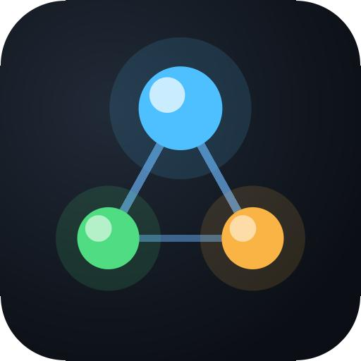
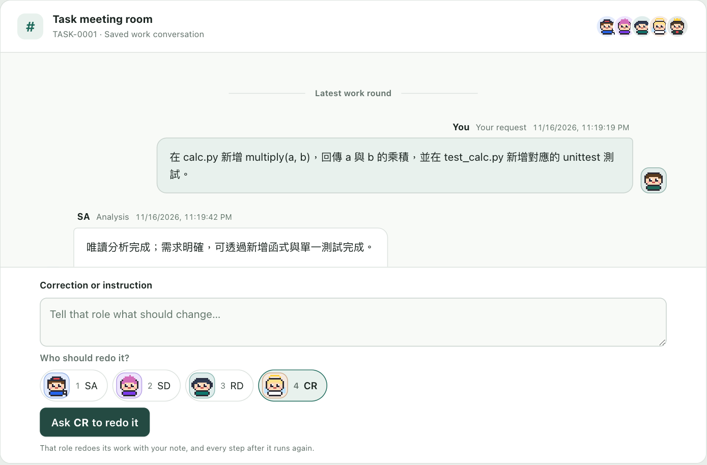

<p align="center">
  
</p>

# ccc-mcp

[](https://github.com/bruce601080102/ccc-mcp/actions/workflows/ci.yaml)
[](https://www.python.org/downloads/)
[](LICENSE)

### Let AI divide the work, and let the evidence show the result.

ccc-mcp lets ChatGPT, Codex and Claude Code collaborate on your local project as a team. It checks their results with host-run tests and your Git diff, and it carries a task across chats and agents.


*Preview, from the current vNext candidate build. The released PyPI version does not have this page yet.*

**Three things it does for you:**

- **A team, not one agent.** Roles such as analyst, developer and reviewer take turns on a task. ChatGPT alone is enough; Codex and Claude Code are optional.
- **Results you can check.** The host runs the tests after a developer step. Each requirement is checked against recorded evidence and shown as **Confirmed**, **Not met** or **Not confirmed yet** (Preview; see [Release status](#release-status)).
- **Continue without starting over.** The task state, plan, shared Context, Git changes and test records stay in your project, so a new ChatGPT chat can pick the task up. A continuation prompt for another agent is a development preview. Only recorded facts move, never a model's internal memory.

**Get started with the released PyPI version:**

```bash
pip install -U ccc-mcp
ccc-mcp ui
```

[Quick start](#quick-start) · [Release status](#release-status) · [Documentation](docs/en/README.md)

## A real task, end to end

You ask: *"Add a multiply function and make sure the tests pass."* Then:

1. **Roles split the work.** Analysis, design, implementation and review are handled by separate roles (ChatGPT, or Codex and Claude Code if you enable them).
2. **The change is recorded** as a Git diff, saved with the task.
3. **After the developer step, the host runs the tests.** Our acceptance run used `python3.14 -m unittest -q` and 2 tests passed. The record stores the interpreter's full local path, which is left out here.
4. **A reviewer checks the change.** Its findings are listed and linked to their files; whether each finding is correct is shown as not yet verified.
5. **The Results page compares each requirement with the evidence.**

**What this run shows (TASK-0001, a local acceptance project).** Two different things appear on the page, and they are not the same check:

- **Saved quality score at completion: 89 out of 100.** A rule-based score, computed when the task finished, and kept as it was.
- **Requirements checked now: 2 of 4 confirmed.** The test for `multiply` and the test command both passed. The `multiply` function is in the code, but nothing ties a test to it yet, so it is not confirmed. The "keep unchanged" requirement needs a person to check it.

Limits of this run: during the acceptance run the PM steps were advanced by hand, so it is not a fully unattended workflow. Its raw records are not published in this repository.

## Quick start

This section describes the released PyPI version. Features marked Preview are not in it.

1. **Install and open the console.**

   ```bash
   pip install -U ccc-mcp
   ccc-mcp ui
   ```

   The console runs on `127.0.0.1` only and prints its address with a one-time token.

2. **Add a project.** In **All projects**, create a project or add an existing folder. From the terminal:

   ```bash
   ccc-mcp project create hello-demo --write
   ccc-mcp project add ./my-folder --write
   ```

   `--write` asks for local confirmation and lets ccc-mcp change that project and run its test command. Read [Create and authorize a first project](docs/en/3-first-project.md) before enabling it on a folder you care about.

3. **Connect ChatGPT.** Create a Tunnel in the OpenAI Platform, run `ccc-mcp connect tunnel_your_id`, and enter the runtime API key at the hidden prompt. See [Connect ChatGPT](docs/en/2-connect-chatgpt.md).

4. **Start a task.** Describe the change to ChatGPT in the connected conversation. From the terminal, `task create` records a requirement and its acceptance criteria:

   ```bash
   ccc-mcp --project hello-demo task create "Add a hello function" --acceptance "Running it prints Hello"
   ```

5. **Read the result.** Open the task in **Tasks**. The released Results tab shows the host test evidence.

**Costs and limits, in four separate parts:**

- **ChatGPT plan.** ChatGPT-only mode uses your existing ChatGPT plan. [ChatGPT plan limits](https://learn.chatgpt.com/docs/pricing) still apply.
- **OpenAI model API.** ChatGPT-only mode does not use a metered OpenAI model API key.
- **Tunnel runtime key.** The Tunnel needs its own runtime API key from the OpenAI Platform. Its billing follows OpenAI's Platform terms, which this project does not control. Check them before you rely on it.
- **Codex and Claude Code.** These optional tools use their own accounts and usage limits.

ccc-mcp does not promise fewer tokens than a single agent. Its workflow adds rounds in exchange for verification, and a per-task token comparison is still being measured.

## Release status

This README covers three different states. Check which one you have before following a command.

| Capability | PyPI release (`pip install ccc-mcp`) | Public GitHub `main` | vNext candidate (Preview, not published) |
| --- | --- | --- | --- |
| Roles, workflows, review gates, chat room | Yes | Yes | Yes |
| Meeting Mode | Yes | Yes | Yes |
| Host test evidence on the Results tab | Yes | Yes | Yes |
| Git diff saved for each step that may change files | Yes | Yes | Yes |
| Per-file diff viewer | No | No | Preview |
| Results checklist and scorecard | No | No | Preview |
| Acceptance Contract, created with each task | No | No | Preview |
| Evidence rules: confirmed, not confirmed, pending | No | No | Preview |
| Quota fallback (`--quota-fallback`) | Yes | Yes | Yes |
| Claude quota sync in the console | Yes | Yes | Yes |
| Skills and MCP tools | Yes | Yes | Yes |
| Handoff panel in the console | No | Yes | Yes |
| `task continue --target` (continuation prompt) | No | Development preview | Yes |
| A bot that runs a workflow without a ChatGPT conversation | No | No | No (roadmap) |

- **PyPI release** is the latest version on PyPI. We checked its wheel: it has no `task continue` command, no checklist, no scorecard and no acceptance contract.
- **Public GitHub `main`** was checked against `origin/main` on 2026-11-18. Commits that exist only in other local branches are not included.
- **vNext candidate** is a local build of the next release. It is verified in one repository only. Its version number is not decided, and nothing has been published.

To try the development preview from source:

```bash
git clone https://github.com/bruce601080102/ccc-mcp.git
cd ccc-mcp
pip install -e .
```

## Roles and workflows

<p align="center">
  
</p>

*The workflow settings page, from the current build. Each role has six abilities scored 0 to 5. The charts and "Team power" are **declared** settings, not measured results.*

- **19 roles.** Each role has a name and avatar you can change. Each one reports in its own words.
- **7 built-in workflows.** Classic, Standard and Full for software work, plus four everyday teams (life, business, content, decision). You can save your own.
- **Review gates.** The adversarial reviewer has Normal, Strict and Extreme strictness. Every blocking claim must cite evidence. Rounds are capped between 1 and 5, after which you decide.
- **Everyday teams** run on ChatGPT, so they can browse. A specification writer turns a discussion into a spec an AI can implement from.
- **Handovers without a wait.** When ChatGPT plays an everyday-team step, the next step starts as soon as the report is handed in.

The six abilities are research, reasoning, planning, creation, verification and risk sense. They are set per role in **Settings**, and they do not enter the quality score. They are not Benchmark results.

<p align="center">
  
</p>

*The task meeting room (released). Roles report in turn, and you can ask any role to redo its step.*

## Results and evidence

- **Host-run tests.** After a developer step, the test command runs on the host, not in the agent's own report. The released Results tab shows the outcome and its record.
- **Git diff.** Each step that may change files saves its diff with the task. The per-file viewer is Preview.
- **Requirement checklist (Preview).** Each requirement shows one of three states:
  - **Confirmed**, only when recorded evidence meets a rule that matches that requirement, such as a passing test tied to it. A text match or an agent's "done" never confirms anything.
  - **Not met**, when recorded evidence contradicts this one requirement, for example a named test ran and failed. It does not mean the whole task failed.
  - **Not confirmed yet**, when evidence is missing or needs a person to check. A missing keyword never makes a requirement fail.
- **Saved score and current check.** The quality score is saved when the task finishes and is not rewritten later. The checklist is checked again against current records, so the two can differ. Both are shown, and neither is a guarantee that the code is correct.

What these checks cannot do: a passing test run does not prove that every requirement is correct, and not every natural-language requirement can be checked automatically. Requirements without a matching check stay pending, for a person to confirm.

The scoring formulas, the reviewer's role in them and the data model are in [Technical reference](docs/en/10-technical-reference.md#evaluation-engine).

## Continue across chats and agents

| What | Where it lives | Status |
| --- | --- | --- |
| Task state and requirement | `.ccc-mcp` in your project | Released; a new ChatGPT chat reads it through MCP tools |
| Approved plan, with version and hash | Stored with the task | Released; included in the continuation prompt |
| Shared Context | `.ccc-mcp/context`, versioned | Released |
| Git changes | Your repository | Read live: `git status` and a diff summary |
| Host test records | Saved by each host run | Released; shown as host evidence, apart from claims |
| Acceptance criteria | Stored with the task; a new version on each change | Preview |

There are three different ways to move work on:

- **Through MCP (released).** A new ChatGPT chat reads the saved task state.
- **Through a prompt (development preview).** `task continue --target` writes a prompt you paste into another session. Nothing is switched for you. Writing the prompt does not mean the next agent has taken over; it still has to read it, work in the same repository and pass the host's tests.
- **Quota fallback (released).** When a role's provider reports quota exhaustion, ccc-mcp can re-dispatch the same task to a fallback provider set with `--quota-fallback`. Dispatching is not completion: the fallback may wait in `CHATGPT_HANDOFF_PENDING` until someone takes it over.

**Not supported:**

- A one-click or fully automatic provider switch.
- Moving Claude's or Codex's internal session memory. Only recorded task state moves.
- Continuing without access to the shared repository.
- Switching an agent that is already running.
- Skipping approval where the project requires it.
- Proof of fewer tokens or better benchmark results.

## A real cross-session test

One recorded run on a small Python project, `continuity-session-test`. Both AI sessions worked in the same repository.

| Step | What happened |
| --- | --- |
| 1. Claude Code (session A) | Implemented `slugify`. The `slugify` tests passed. `count_words` still raised `NotImplementedError`. |
| 2. Handoff | Ran `ccc-mcp --project <id> task continue --target codex` to produce the continuation prompt. |
| 3. Codex (new session B) | Read the prompt, the shared Context and the repository. After the user explicitly authorized the second phase, implemented `count_words` and kept Claude's `slugify` change. |
| 4. Local check | The user ran `python -m pytest -q`: **2 passed**. `git diff --check` was clean. No existing test was changed. Nothing was committed or pushed. |

**How to read this run.** The two sessions did not share chat history. The handoff was the generated prompt plus the shared Context. The second phase ran only after explicit authorization. The "2 passed" is a local pytest run by the user; it is not a formal ccc-mcp host TEST-RESULT, and ccc-mcp's own PM gate was not completed automatically.

**What it does not show:** that every project or every switch works this way, that the new agent remembers the earlier session, or that tokens or time went down.

## Proof: three selected SWE-bench Verified cases

Using **ChatGPT-only**, ccc-mcp resolved three selected [SWE-bench Verified](https://www.swebench.com/) Astropy instances after iterative repair. Each has a local run of the official evaluation harness reporting `resolved: true`:

| Instance | Harness report |
| --- | --- |
| `astropy__astropy-12907` | [report.json](benchmarks/swebench-verified/12907-report.json) |
| `astropy__astropy-13236` | [report.json](benchmarks/swebench-verified/13236-report.json) |
| `astropy__astropy-13398` | [report.json](benchmarks/swebench-verified/13398-report.json) |

[Read the evidence and methodology](benchmarks/swebench-verified/README.md), including run IDs and the ChatGPT development conversations. These are **three selected cases**, not a full-benchmark score, not a result on all 500 Verified instances, and not an official leaderboard submission. The raw logs are kept locally and are not in this repository.

## Watch the demo

**An earlier recording of the console (1080p, 60 fps, with audio, 63 seconds).** It was made before the current Results page, so it does not show the checklist or the scorecard.

https://github.com/user-attachments/assets/eb7512b3-7f67-4a2e-aa7a-9e4b06a9a7d2

The [original recording is on Google Drive](https://drive.google.com/drive/folders/15vn8wYrZ55JL5Aetb1IR6YGm7fK1i81m). This recording does not show the cross-session handoff; see [A real cross-session test](#a-real-cross-session-test).

## Web console

```bash
ccc-mcp ui
```

The console runs in the same process as the CLI and MCP server, with no separate frontend to build and no Node.js needed. It binds `127.0.0.1` only, prints its address and opens your browser. Use `--port` to pin a port, or `--no-browser` to skip opening one. It reads the same `--home` database as the CLI and MCP server.

| Page | What you can do |
| --- | --- |
| **Command center** | Track task activity, blockers and agent evaluation history. Optionally enable Claude quota sync, which reads the official remaining percentages from Claude Code's status line. Account-wide token totals are shown separately and cannot be attributed to one project. |
| **All projects** | Create projects, add folders, organize groups, import a project backup and manage write access. |
| **Settings** | Set the profile, providers and roles, workflows and review gates, report language, test command and Meeting Mode. |
| **Tasks** | Open a task: the work conversation, the Results tab, the technical record and the handoff panel. |
| **Context** | Inspect the shared Context and its versions. |
| **Connect** | Connect ChatGPT with a Tunnel ID and runtime API key, and inspect status and logs. Stored keys are never returned to the browser. |
| **Global Skills** | Choose local Claude Code or Codex Skills to install for every project and role. |
| **Skills & MCP** | View shared Skills; discover, install and manage local stdio MCP servers and their tools for one project. |
| **Documentation** | Read the bundled English and Traditional Chinese guides. |

Claude quota sync is opt-in. It adds a small wrapper to Claude Code's user `statusLine` setting, keeps any existing status line, and stores only reported percentages, reset times and the observation time. It does not call Claude's model or read login credentials. Disabling it restores the previous setting. See [reliability and security](docs/en/7-reliability-and-security.md#web-console).

## CLI: automation and advanced use

The CLI works on the same project data:

```bash
ccc-mcp project create hello-demo --write
ccc-mcp --project hello-demo task status
ccc-mcp --project hello-demo task usage
ccc-mcp --project hello-demo context show
```

If you only use ChatGPT, select the `chatgpt-only` profile in **Settings**, or run `ccc-mcp --project hello-demo config profile chatgpt-only`. Native Codex and Claude Code roles need `ccc-mcp setup all` and their own sign-in. For native roles, `task usage` shows whether the CLI was actually invoked. ChatGPT roles are interactive, so `cli_invoked: false` is expected there. See the [CLI reference](docs/en/8-cli-reference.md) for every command.

## Security boundary

Continuous write authorization, granted by `--write` or the console's "Enable write", lets ccc-mcp change that project and run its configured test command. Dependency installation can run package scripts, so review dependency changes as part of the diff. Codex runs in its configured sandbox. Claude Code has a restricted tool policy but no equivalent OS-enforced sandbox, so run it under a least-privileged OS account.

To remove a project from `project list` while keeping its folder, use `ccc-mcp project remove <id>`. `project delete` is different: it permanently retires the ID and keeps its history. See [reliability and security](docs/en/7-reliability-and-security.md) for the full guarantee.

## Documentation

Read the numbered documents in order for a full setup. The two language trees use the same filenames and sequence.

| Step | Topic |
| --- | --- |
| 1 | Install and sign in |
| 2 | Connect ChatGPT |
| 3 | Create and authorize a first project |
| 4 | Run and resume the workflow |
| 5 | Configure providers, roles, context and tests |
| 6 | Install and use skills |
| 7 | Understand reliability and security boundaries |
| 8–11 | CLI reference, public protocol, technical reference and architecture |

- [Traditional Chinese README](README_ZH.md)
- [English documentation index](docs/en/README.md)

## Roadmap

> These are goals, not features you can use today. There is no release date.

**A bot that runs a workflow on its own.** Today a ChatGPT conversation plays the project manager and drives the workflow. Codex and Claude Code can take individual roles, but a ChatGPT chat still starts and steers the task.

The next goal is a bot-style entry that needs no ChatGPT conversation: connect Codex, Claude or another model directly and chain them into a workflow the way you compose one today. The role flow and its gates, the chat room, the declared ability charts, and evidence from the host's own test runs are meant to carry over unchanged.

## Development

```bash
python3.11 -m pytest -q
```

The repository requires Python 3.11 or newer. Real-agent tests are opt-in because they need locally installed, signed-in CLIs; see the [installation guide](docs/en/1-install-and-sign-in.md).

## Releasing

You choose when to run checks and when to publish. Nothing runs automatically after a push or pull request. Start **CI** manually for a short lint and focused test run on Linux and Windows; it does not build release artifacts, change the version or publish. When you are ready, start **Release** manually from `main` and enter the version in the GitHub form, without a `v` prefix. Release runs the full test matrix, builds and installs the wheel, verifies the wheel and sdist, tags the matching versioned source commit, and publishes to GitHub Releases and PyPI. It does not change the version file on `main`.
