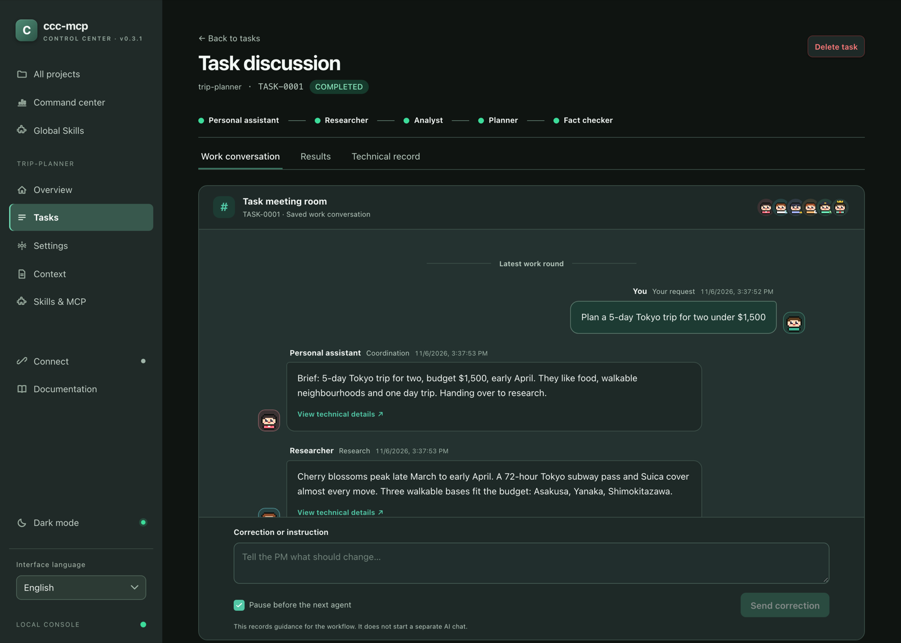
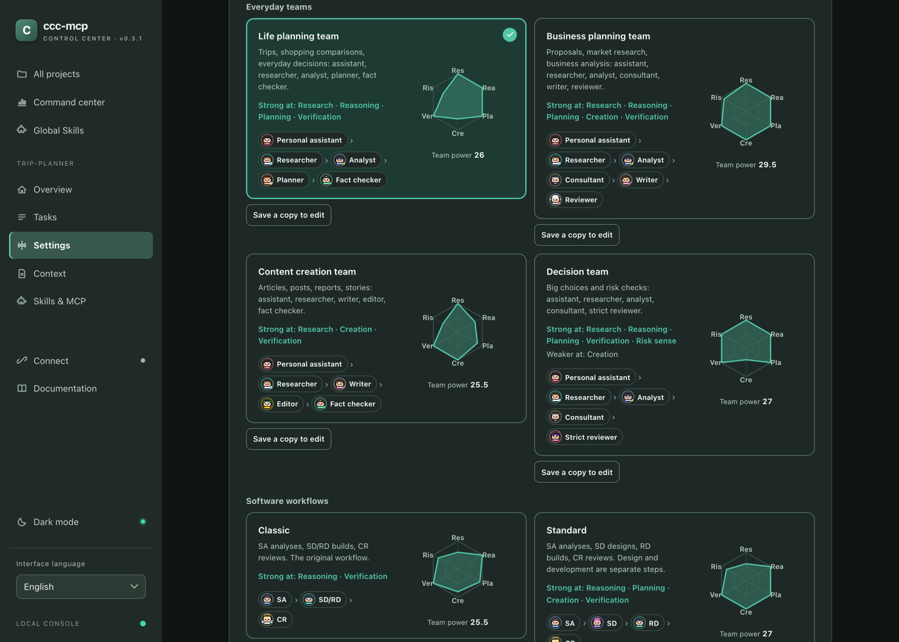
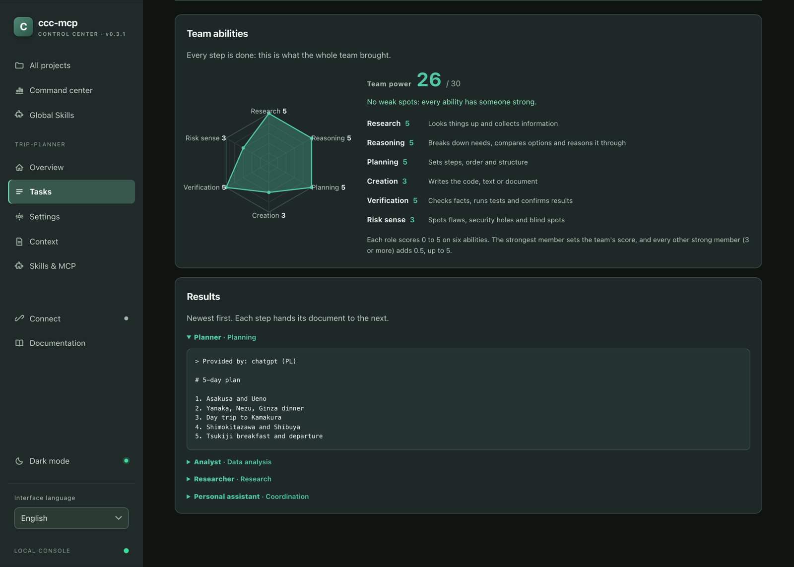
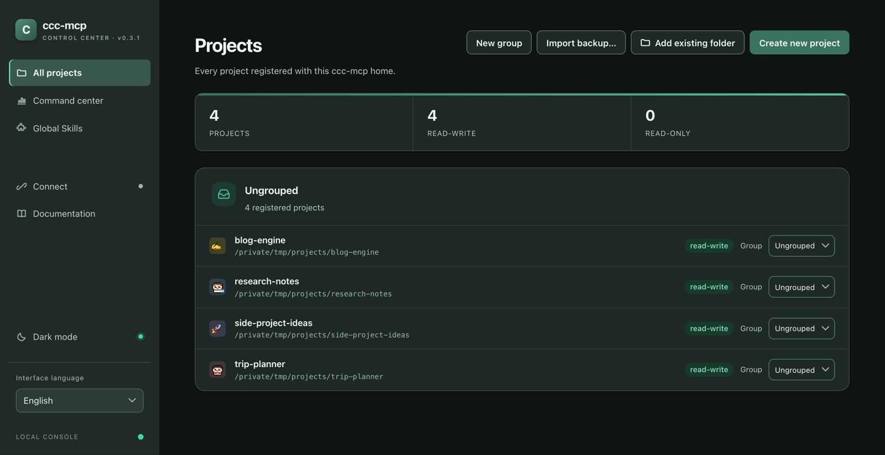

<p align="center">
  
</p>

# ccc-mcp

[](https://github.com/bruce601080102/ccc-mcp/actions/workflows/ci.yaml)
[](https://www.python.org/downloads/)
[](docs/en/1-install-and-sign-in.md)
[](https://modelcontextprotocol.io/)
[](LICENSE)

[](docs/en/2-connect-chatgpt.md)
[](docs/en/4-workflow.md)
[](docs/en/4-workflow.md)

**Switch AI. Keep Your Progress.**

Mid-task, switching AI usually means starting over. You re-explain what was decided, what already works, what is still missing, and what the tests actually said, and the new AI still guesses wrong about something.

**ccc-mcp keeps that state in your repository and writes a handoff prompt from it.** The prompt is built from the saved task, the approved plan, shared Context, live Git status and the tests the host ran. The next AI starts from recorded facts, not from your summary.

**Why not copy a summary by hand?** Your summary is only as complete as your memory. The generated handoff keeps what the host verified apart from what an Agent claimed, and it lists the uncommitted changes that must survive the switch.

**Real evidence.** In one recorded run, Claude Code implemented `slugify`, and a new Codex session continued from the handoff and implemented `count_words`. A pytest run done locally by the user passed (2 passed). It is not a ccc-mcp Host TEST-RESULT. The conditions and limits of that run are in [A real cross-session test](#a-real-cross-session-test).

**Try it now.**

- Released version (PyPI 0.3.2): `pip install ccc-mcp`, then `ccc-mcp ui`. Version 0.3.2 has no `task continue` command yet.
- Handoff command (Development Preview, from `main`): install from source as shown in [Install and release status](#install-and-release-status).

```bash
ccc-mcp --project my-project task continue --target codex
```

ChatGPT-only is a complete setup. It runs on your existing ChatGPT plan with no separately metered model API, so you do not need a second AI subscription. Claude Code and Codex CLI are optional.

> [繁體中文 README](README_ZH.md) · [English documentation](docs/en/1-install-and-sign-in.md)

## A real cross-session test

One recorded run on a small Python project, `continuity-session-test`. Both AI sessions worked in the same repository.

| Step | What happened |
| --- | --- |
| 1. Claude Code (session A) | Implemented `slugify`. The `slugify` tests passed. `count_words` still raised `NotImplementedError`. |
| 2. Handoff | Ran `ccc-mcp --project <id> task continue --target codex` to produce the Continuation Prompt. |
| 3. Codex (new session B) | Read the prompt, the shared Context and the repository. After the user explicitly authorized the second phase, implemented `count_words` and kept Claude's `slugify` change. |
| 4. Local check | The user ran `python -m pytest -q`: **2 passed**. `git diff --check` was clean. No existing test was changed. Nothing was committed or pushed. |

**How to read this run**

- Same repository, different AI sessions. Session B did not inherit session A's chat history.
- The handoff was the generated Continuation Prompt plus ccc-mcp's shared Context.
- The second phase ran only after the user explicitly authorized it.
- The `2 passed` is a local pytest run by the user. It is not a ccc-mcp formal Host TEST-RESULT, and ccc-mcp's own PM gate was not completed automatically.

**What it does not show:** that every project or every switch works this way, that the new AI remembers the earlier session, or that tokens or time went down.

## How the handoff works

ccc-mcp is a local MCP server and command-line tool. It connects ChatGPT Chat, Claude Code or Codex CLI to an **authorized repository**, and it follows one rule: don't take an AI's word that the code works. The host runs the tests. Every diff, test result and review is saved in the project's `.ccc-mcp` data, so a task can be resumed from another chat. **ChatGPT-only is the primary workflow.** Codex and Claude Code are optional providers for teams that want to split roles across tools.

The shared Context and the Approved Plan are the source of truth. The prompt carries them to the next AI. It includes:

- **Task and plan:** the requirement, the acceptance criteria, and the approved plan's ID, version, hash and text. If no plan is approved, or the newest plan is an unapproved draft, the prompt says so and does not present the draft as an order.
- **Claims and host evidence, kept apart:** each Agent's report is labeled as its own claim. Host-run test results are labeled as host evidence. A claim the host has not verified is marked as not done.
- **Remaining work:** derived from the task's state. Where ccc-mcp cannot tell what is left, the prompt says "to confirm" and names the files to check.
- **Live Git state:** `git status` and a diff summary, with an instruction not to break existing uncommitted changes.
- **Source paths:** the files the next AI should read to check each point.

Use `--target claude`, `--target codex` or `--target chatgpt` to address the prompt to a specific AI. Without `--target`, you get the plain handoff report.

Writing the prompt does not mean the next AI has taken over. The new session still has to read it, work in the same repository, and pass the host's tests.

## Continue work with another AI

Three mechanisms are involved. They are separate, so read the status column.

| Mechanism | How it works | Status |
| --- | --- | --- |
| **Prompt-first handoff** | You run `task continue --target` and paste the prompt into the new session. Nothing is switched for you. | Development Preview: on `main`, not in PyPI 0.3.2 |
| **Shared Context and MCP-assisted resume** | A new ChatGPT chat reads the saved task state from the project's `.ccc-mcp` data through ccc-mcp's MCP tools. | In the released version |
| **Quota fallback** | When a role's provider reports quota exhaustion, ccc-mcp can re-dispatch the same task to a fallback provider you configured with `--quota-fallback`. Dispatching is not completion: the fallback may wait in `CHATGPT_HANDOFF_PENDING` until someone takes it over. | In the released version |

**Not supported yet:**

- A one-click or fully automatic provider switch.
- Moving a Claude or Codex internal session memory. Only the recorded task state moves.
- Continuing without the shared repository. The next AI needs access to the same repository and the files the task touches.
- Switching an Agent that is already running. There is no live preemption.
- Skipping approval. Plans still need approval where the project requires it.
- Proof of fewer tokens or better benchmark results.

## Install and release status

The `main` branch is ahead of the last PyPI release. Check which one you have before you follow a command in this README.

| Feature | PyPI 0.3.2 (`pip install ccc-mcp`) | `main` (source checkout) |
| --- | --- | --- |
| Shared Context, task records, host-run tests | Yes | Yes |
| Quota fallback (`--quota-fallback`) | Yes | Yes |
| `task continue --target` Continuation Prompt | No | Development Preview |
| Handoff panel in the console (Technical record) | No | Not on `main` yet |

**Released version:**

```bash
pip install ccc-mcp
ccc-mcp ui
```

**Development Preview (the handoff command):** committed to `main` and pushed, but not yet released. Install from source:

```bash
git clone https://github.com/bruce601080102/ccc-mcp.git
cd ccc-mcp
pip install -e .
ccc-mcp --project <id> task continue --target codex
```

A source checkout still reports version 0.3.1 until the next release. If `ccc-mcp --project <id> task continue --help` says there is no such command, you have the released version.

## More features

<p align="center">
  
</p>

### A chat room of AI specialists
Work is a conversation. **19 roles** (analyst, designer, developer, code reviewer, security reviewer, researcher, writer, fact checker and more) each have a **pixel avatar and a name you choose**, and report in their own voice as the task moves from one to the next. Pause, stop, or leave a correction at any point. No more guessing who is working now or what the last one did.

### Workflows you compose, with gates that push back
<p align="center">
  
</p>

**7 built-in workflows** (Classic, Standard, Full, and four everyday teams) plus any you build and save yourself. ChatGPT, ccc-mcp, or you can choose the workflow per task. **Review gates** send work back to the step that made it: the adversarial reviewer has *Normal / Strict / Extreme* strictness, every blocking claim must cite evidence, and the number of rounds is capped (1–5). When a gate runs out of rounds, you decide instead of the agents looping forever.

### Not only for code
Four ready-made **everyday teams** put the same machinery to work on a trip plan, a business proposal, an article or a big decision: *assistant → researcher → analyst → planner → fact checker*, and so on. They run on ChatGPT, so they can browse. A **specification writer** turns a discussion into a spec an AI can implement from.

### Game-style ability charts
<p align="center">
  
</p>

Every role scores 0–5 on six abilities: **research, reasoning, planning, creation, verification, risk sense**. Each workflow shows the combined **team chart and team power**, names the abilities nobody on the team is good at, and the chart **grows step by step** while a task runs. Pick a team by what it is good at, not by guessing.

### Handovers without the wait
When ChatGPT plays an everyday-team step, the next step starts as soon as it hands in its report: no extra “PM round” between roles. Tasks stay resumable, and everything runs on your existing ChatGPT plan.

### A local control center that feels yours
<p align="center">
  
</p>

`ccc-mcp ui` gives you projects (with **custom icons**: a pixel character, an emoji or a letter, in your color), groups, settings, Context, Skills and MCP tools in one place. Light and dark themes, English and Traditional Chinese, and a layout that works on a phone.

### Pause, correct and resume

Read each task as an evidence-backed conversation. Pause, resume, stop, or leave a correction from the local UI. Saved handoffs keep ChatGPT and the next agent informed.

### Traceable execution evaluation

The optional evaluation engine scores finished executions from saved evidence: host tests, the diff and lint findings. See [How execution evaluation works](#how-execution-evaluation-works).

### Skills and MCP tools

Install reusable `SKILL.md` guidance, including nested supporting files, and choose global Skills in the UI so every project and role can use them. Discover local MCP servers, install one for a project, select which tools the project may use, and call them from ChatGPT. For example, `codebase-memory-mcp` can provide repository structure and code relationships. Skills guide the workflow; MCP tools supply live capabilities.

## Watch the demo

**1080p · 60 fps · with audio · 63 seconds.**

https://github.com/user-attachments/assets/eb7512b3-7f67-4a2e-aa7a-9e4b06a9a7d2

The [original recording is on Google Drive](https://drive.google.com/drive/folders/15vn8wYrZ55JL5Aetb1IR6YGm7fK1i81m). The separate [SWE-bench evidence](#proof-three-selected-swe-bench-verified-cases) records the official harness results.

This recording does not show the cross-session handoff. For that test, see [A real cross-session test](#a-real-cross-session-test).

Want to try it yourself? The quick start below takes you from `ccc-mcp ui` to a ChatGPT conversation connected to an authorized local project.

## Start with the UI

Install the released version, then open its local control center. The `task continue --target` handoff is not in this release; see [Install and release status](#install-and-release-status).

```bash
pip install ccc-mcp
ccc-mcp ui
```

Requires Git and Python 3.11+. In the UI:

1. **Projects:** create a project or add an existing folder, then enable write access for the project.
2. **Connect:** follow [Connect ChatGPT](docs/en/2-connect-chatgpt.md) to create an OpenAI Platform Tunnel. Enter its Tunnel ID and runtime API key in the console.
3. **Settings:** select the `chatgpt-only` profile. The **Test command** can be left blank: ccc-mcp installs declared Python dependencies and chooses tests from changed test files when possible. Set a command when you need a specific scope.
4. **ChatGPT:** select the ccc-mcp connection and ask it to make a change. Inspect **Tasks** and **Context** in the UI to see the actual edits, test results, and next step.

The UI runs on local `127.0.0.1` and stops with Ctrl+C. [See every console page](#web-console).

**About tokens and keys:** This workflow uses your existing ChatGPT plan instead of an OpenAI *model* API key and its per-token API billing. [ChatGPT plan limits](https://learn.chatgpt.com/docs/pricing) still apply. ccc-mcp does not claim to use fewer tokens than a single agent: the `SA → SD/RD → REVIEW` workflow adds rounds in exchange for verification, and a per-task token comparison is still being measured. The Tunnel connection uses its own runtime API key; [connection setup](docs/en/2-connect-chatgpt.md) explains that key.

## How execution evaluation works

The evaluation engine (opt-in, off by default) scores a completed SA/SD/RD/REVIEW execution from evidence that is already saved — the host-run test result, the execution's diff, and `ruff` static analysis — **with no additional LLM call and no extra token cost**. It never asks an Agent whether its own work passed, and never treats one Agent's agreement with another as proof of correctness.

Two numbers are reported separately, on purpose:

- **`quality_score`** is the weighted average of only the sub-scores that actually have evidence behind them, using the role's configured weights (test/requirement/code-quality/security/review — editable per role, with one-click presets, in the web console's settings page).
- **`evidence_coverage`** is the share of that role's weight budget those sub-scores actually cover. A `quality_score` of 100 with 70% coverage means "everything we could check looked perfect, but we could only check 70% of what this role is normally judged on" — not "100% confidence."

A small set of hard rules decides `task_status` separately from the weighted score: a failing acceptance test, or a test suite that never ran, can never read as `PASSED`, no matter how high the weighted average is. A Beta-Bernoulli reputation tracker (`ccc-mcp reputation`) keeps per-agent/model/role/task-type reliability across every project, with wide, explicit uncertainty while sample sizes are small — never a confident number from too little data.

See [Technical reference](docs/en/10-technical-reference.md#evaluation-engine) for the exact formulas and data model.

## Proof: three selected SWE-bench Verified cases

Using **ChatGPT-only**, ccc-mcp resolved three selected [SWE-bench Verified](https://www.swebench.com/) Astropy instances after iterative repair. Each has a local run of the official evaluation harness reporting `resolved: true`:

| Instance | Harness report |
| --- | --- |
| `astropy__astropy-12907` | [report.json](benchmarks/swebench-verified/12907-report.json) |
| `astropy__astropy-13236` | [report.json](benchmarks/swebench-verified/13236-report.json) |
| `astropy__astropy-13398` | [report.json](benchmarks/swebench-verified/13398-report.json) |

[Read the evidence and methodology](benchmarks/swebench-verified/README.md), including run IDs and ChatGPT conversations. These are **3 selected cases**, not a full-benchmark score or an official leaderboard submission.

## ChatGPT first; other agents are optional

With the `chatgpt-only` profile selected, ChatGPT handles the project manager and every role of the selected workflow. The workflow records each handoff so the next chat can pick up the saved state.

In `chatgpt-only`, ChatGPT can read and edit an authorized local project, then continue the work in the same conversation. No Codex or Claude Code installation is required. It runs on your existing ChatGPT plan, with no separately metered model API.

```text
ChatGPT Chat → local project → tests, diff, review
       ↑                            │
       └──── saved Context and next step ────┘
```

If you want a multi-agent workflow, assign supported roles to Codex or Claude Code through their native CLIs. Configure providers, effort, quota fallback, test command, and report language in **Settings**. See the [workflow guide](docs/en/4-workflow.md).

## Roadmap

> These are goals, not features you can use today. There is no release date.

**Bots that run a workflow on their own.** Today a ChatGPT conversation plays the project manager and drives the workflow. Codex and Claude Code can take individual roles, but a ChatGPT chat still starts and steers the task.

The next goal is a bot-style entry that needs no ChatGPT conversation: connect Codex, Claude, or another model directly, and chain them into a workflow the same way you compose one today. The pieces you already have should carry over unchanged: the role flow and its gates, the chat room that shows who said what, the ability charts, and evidence from the host's own test runs instead of self-reports.

## Web console

```bash
ccc-mcp ui
```

Starts a local web console in the same process that already serves the CLI and MCP server — no separate frontend to clone, build, or run, and no Node.js required even if you build from source (the UI ships as plain HTML/CSS/JS bundled into the `ccc-mcp` wheel). It binds `127.0.0.1` only, prints its URL, and opens your browser; pass `--port` to pin a port (ccc-mcp reports clearly if that port is taken) or leave it out to pick a free one automatically, and `--no-browser` to skip the auto-open. Press Ctrl+C to stop it. It reads the same `--home` database the CLI and MCP server use, so projects and tasks are always in sync across all three.

The console's main pages:

| Page | What you can do |
| --- | --- |
| **Command center** | Track task activity, blockers, project load, and agent evaluation history. Filter this workspace's CLI token records from five minutes to one month; see Codex plan-window remaining percentages and reset times. Enable Claude quota sync in the UI and click Check now: ccc-mcp briefly opens Claude Code in the background (one tiny Haiku message, no terminal needed) and shows its official five-hour and seven-day remaining percentages. The page checks local data every five minutes while open. Account-wide lifetime tokens are separate and cannot be attributed to a Chat, Codex run, or ccc-mcp project. |
| **All projects** | Create projects, add existing folders, organize groups, import a single-project backup, and manage write access. Export settings and work history from a project's overview. |
| **Settings** | Set the profile, providers and roles (with avatars, names and ability charts), workflows and review gates, report language, test command, and Meeting Mode. |
| **Tasks / Context** | Inspect stages, waiting reasons, execution history, usage and CLI invocation evidence, raw results, and shared context. |
| **Connect** | Connect ChatGPT with an OpenAI Platform Tunnel ID and runtime API key; inspect status and logs. |
| **Global Skills** | Select local Claude Code or Codex Skills to install for every project and role; inspect or remove installed Skills. |

Claude quota sync is opt-in: open **Command center → Usage and remaining allowance → Enable Claude quota sync**. It adds a small wrapper to your Claude Code user `statusLine` setting and preserves and runs an existing status line. The usage snapshot in the local ccc-mcp home contains only reported percentages, reset times, and observation time; separate installation metadata retains the previous status-line setting for restoration. Open an interactive Claude Code session and receive one response to populate the values; Claude Code supplies these fields only after an API response. The dashboard checks the local snapshot every five minutes, labels older observations, and removes expired windows. **Disable Claude quota sync** restores the previous setting and deletes the local snapshot. This does not call Claude's model or read its login credentials. See [Anthropic's status-line field documentation](https://code.claude.com/docs/en/statusline).
| **Skills & MCP** | View shared Skills; discover, install, and manage local stdio MCP servers and their tools for one project. |
| **Documentation** | Read the bundled English and Traditional Chinese guides inside the console. |

In **Skills & MCP**, inspect tools, choose which ones this project may use, invoke enabled tools with JSON arguments, and view recent MCP calls. Globally installed MCP servers also appear there, but still require the CLI to remove. The sidebar's interface language is separate from each project's report language. **Connect** can remember a runtime API key on this device (`~/.ccc-mcp/tunnel/credentials.json`, readable only by your OS account); stored keys are never returned to the browser. Enabling write, clearing history, and deleting require typed confirmation. See [reliability and security](docs/en/7-reliability-and-security.md#web-console) for details.

On **All projects**, create named groups, move project cards with the dropdown or drag-and-drop, and reorder groups. This only changes local console organization (`<home>/ui/project_groups.json`), not project paths or settings. **Connect** can save multiple named profiles, including different keys for the same Tunnel ID; select a saved profile and click Connect to use it. One Tunnel connection runs at a time.

## CLI: automation and advanced use

If you prefer a terminal or write scripts, the CLI operates on the same project data. `ccc-mcp setup all` and signing in to Codex or Claude Code are only needed if you plan to use those **optional** native roles. For example, to create a project entirely from the CLI:

```bash
ccc-mcp project create hello-demo --write
ccc-mcp --project hello-demo task status
ccc-mcp --project hello-demo task usage
ccc-mcp --project hello-demo context show
```

`--write` asks for local confirmation while creating the project, authorizing ccc-mcp to write there and run its configured test command. For an existing folder, use `ccc-mcp project add <folder> --write`. If you only use ChatGPT, skip `setup all` and select `chatgpt-only` in the project's **Settings**, or run `ccc-mcp --project hello-demo config profile chatgpt-only`.

For native roles, `task usage` shows whether the CLI was actually invoked. ChatGPT roles are interactive: `task usage` marks them `"interactive": true` with `invocation.source: "chatgpt_web"`, so `cli_invoked: false` is expected. See the [CLI reference](docs/en/8-cli-reference.md) for all commands.

## Documentation

Read the numbered documents in order for a full setup. The two language trees use the same filenames and sequence.

| Step | Topic |
| --- | --- |
| 1 | Install and sign in |
| 2 | Connect ChatGPT |
| 3 | Create and authorize a first project |
| 4 | Run and resume the workflow |
| 5 | Configure providers, roles, context, and tests |
| 6 | Install and use skills |
| 7 | Understand reliability and security boundaries |
| 8–11 | CLI reference, public protocol, technical reference, and architecture |

- [Traditional Chinese README](README_ZH.md)
- [English documentation index](docs/en/README.md)

## Important boundary

Continuous write authorization — granted via `project authorize`, `project add --write`/`project create --write`, or the web console's "Enable write" — permits ccc-mcp to modify that project and run its configured test command. Dependency installation can execute package scripts, so review dependency changes as part of the diff. Codex runs in its configured sandbox. Claude Code has a restricted tool policy, but does **not** yet have an equivalent OS-enforced sandbox; use a least-privileged OS account for it.

To remove a project from `project list` while keeping its folder, use `ccc-mcp project remove <id>` (or the web console's **Remove, keep folder** action). This clears ccc-mcp records by default; registering the same ID again starts with empty records. Add `--delete-files` to delete the project folder too, or `--keep-records` to retain an archive of the old records. The web console offers the same **Keep records** checkbox in either removal flow. The CLI and web console require typed confirmation, and running executions must finish or be cancelled first. `project delete` is different: it permanently retires the ID and preserves historical records and files. See [reliability and security](docs/en/7-reliability-and-security.md) for the full guarantee.

## Development

```bash
python3.11 -m pytest -q
```

The repository requires Python 3.11 or newer. Real-agent tests are opt-in because they need locally installed, authenticated CLIs; see [Chinese](docs/ch/1-install-and-sign-in.md) or [English](docs/en/1-install-and-sign-in.md).

## Releasing

You choose when to run checks and when to publish. Nothing runs automatically after a push or pull request. Start **CI** manually for a short lint and focused test run on Linux and Windows; it does not build release artifacts, change the version, or publish. When ready, start **Release** manually from `main` and enter the version in the GitHub form (for example `0.3.0`, without `v`). Release runs the complete Python and platform test matrix, builds and installs the wheel, verifies the wheel and sdist, and tags the matching versioned source commit before publishing to GitHub Releases and PyPI. It does not update `main`'s version file.
