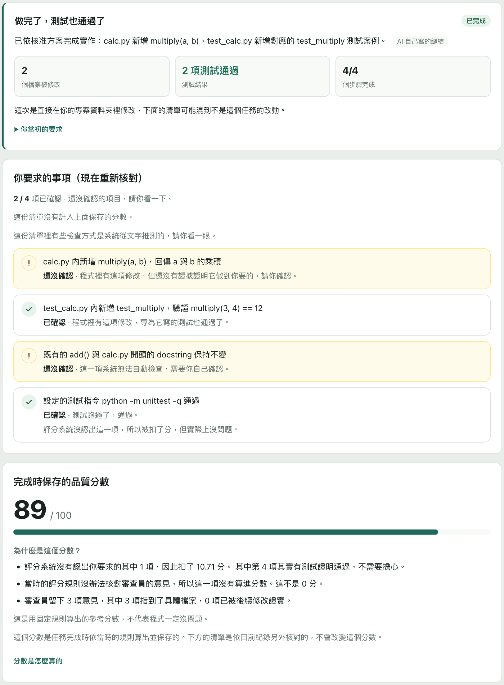
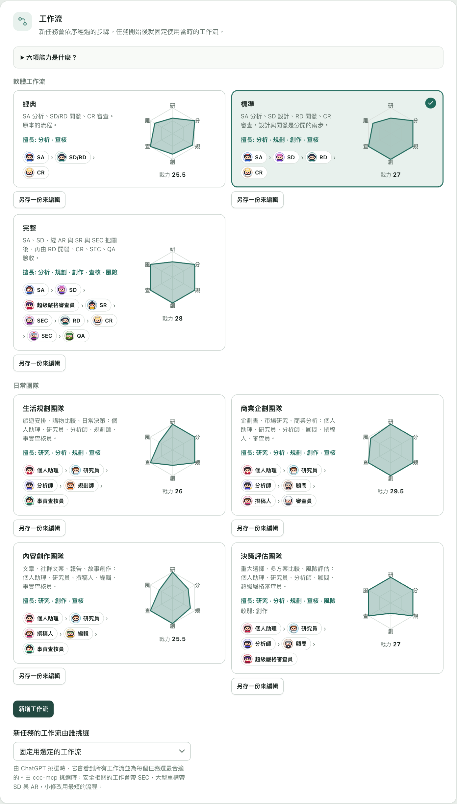
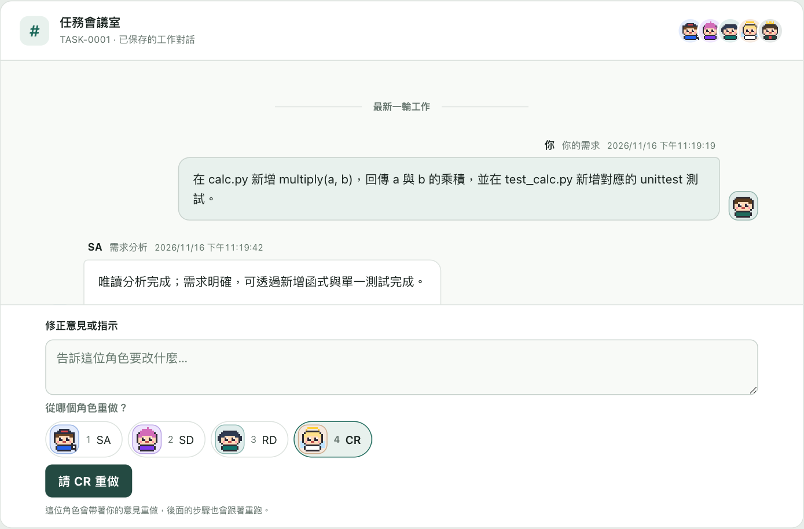

<p align="center">
  
</p>

# ccc-mcp

[](https://www.python.org/downloads/)
[](LICENSE)

### 讓 AI 分工做事，讓證據說明結果。

ccc-mcp 讓 ChatGPT、Codex 與 Claude Code 在你的本機專案上以團隊方式協作，用主機執行的測試與 Git diff 檢查成果，並讓任務跨對話、跨 Agent 接續。



*預覽，來自目前的 vNext 候選版。已發行的 PyPI 版本還沒有這一頁。*

**它替你做三件事：**

- **一個團隊，不是一個 Agent。** 分析師、開發者、審查員等角色依序處理同一個任務。只用 ChatGPT 就能完整運作；Codex 與 Claude Code 是選用工具。
- **可以檢查的成果。** 開發步驟之後由主機執行測試。每條要求依已記錄的證據，顯示為**已確認**、**沒做到**或**還沒確認**（預覽功能，見[發行狀態](#發行狀態)）。
- **接續時不必從頭開始。** 任務狀態、計畫、共用 Context、Git 修改與測試紀錄都留在你的專案裡，新的 ChatGPT 對話即可接續。給其他 Agent 的接續 Prompt 目前是開發預覽。移動的只是已記錄的事實，不是任何模型內部的記憶。

**用已發行的 PyPI 版本開始：**

```bash
pip install -U ccc-mcp
ccc-mcp ui
```

[快速開始](#快速開始) · [發行狀態](#發行狀態) · [文件](docs/ch/README.md)

## 一個真實任務，從頭到尾

你提出需求：*「請幫我新增一個乘法函式，並確認測試通過。」*接著：

1. **角色分工。** 分析、設計、實作與審查由不同角色處理（使用 ChatGPT；若你啟用，也可以用 Codex 與 Claude Code）。
2. **修改被記錄為 Git diff**，隨任務保存。
3. **開發步驟之後，主機執行測試。** 我們的驗收執行使用 `python3.14 -m unittest -q`，2 項測試通過。紀錄中保存了直譯器的完整本機路徑，這裡省略。
4. **審查員檢查修改。** 審查意見會列出並對應到檔案；意見本身是否正確，仍顯示為尚未驗證。
5. **成果頁把每條要求與證據對照。**

**這次執行說明什麼（TASK-0001，本機驗收專案）。** 頁面上有兩件不同的事，它們不是同一次核對：

- **完成時保存的品質分數：89 分（滿分 100）。** 任務完成時依規則算出的分數，保存後不會改寫。
- **目前重新核對的要求：4 條中 2 條已確認。** 乘法函式的測試與測試指令都通過了。`multiply` 函式已經在程式裡，但還沒有測試明確對應到它，所以尚未確認。「保持不變」的要求需要人工檢查。

這次執行的限制：驗收時 PM 的推進步驟是人工操作的，所以它不是完全無人值守的工作流。原始紀錄沒有發布在這個 repository 中。

## 快速開始

這一節說明的是已發行的 PyPI 版本。標示為預覽的功能不在這個版本中。

1. **安裝並開啟主控台。**

   ```bash
   pip install -U ccc-mcp
   ccc-mcp ui
   ```

   主控台只在 `127.0.0.1` 提供服務，啟動時會印出網址，附帶一次性的本機 token。

2. **加入專案。** 在**所有專案**頁建立專案或加入既有資料夾。也可以用終端機：

   ```bash
   ccc-mcp project create hello-demo --write
   ccc-mcp project add ./my-folder --write
   ```

   `--write` 會要求你在本機確認，之後允許 ccc-mcp 修改該專案並執行它的測試指令。在重要的資料夾上開啟前，請先讀[建立並授權第一個專案](docs/ch/3-first-project.md)。

3. **連接 ChatGPT。** 在 OpenAI Platform 建立 Tunnel，執行 `ccc-mcp connect tunnel_你的ID`，並在隱藏的提示輸入 runtime API key。詳見[連接 ChatGPT](docs/ch/2-connect-chatgpt.md)。

4. **開始任務。** 在已連線的 ChatGPT 對話中描述要做的修改。若在終端機操作，`task create` 會記錄需求與驗收條件：

   ```bash
   ccc-mcp --project hello-demo task create "新增 hello 函式" --acceptance "執行後輸出 Hello"
   ```

5. **查看結果。** 在**任務**頁打開任務。已發行版本的**成果**分頁會顯示主機測試證據。

**費用與限制，分成四個獨立部分：**

- **ChatGPT 方案。** ChatGPT-only 模式使用你現有的 ChatGPT 方案，[ChatGPT 方案本身仍有使用限制](https://learn.chatgpt.com/docs/pricing)。
- **OpenAI 模型 API。** ChatGPT-only 模式不使用計量計費的 OpenAI 模型 API 金鑰。
- **Tunnel runtime key。** Tunnel 需要在 OpenAI Platform 取得獨立的 runtime API key。它的計費依 OpenAI Platform 的條款，本專案無法決定，使用前請先確認。
- **Codex 與 Claude Code。** 這些選用工具使用各自的帳號與使用限制。

ccc-mcp 並不宣稱比單一 Agent 更省 token。工作流為了驗證而增加了幾輪，每個任務的 token 比較仍在量測中。

## 發行狀態

這份 README 同時描述三種不同的狀態。依照指令操作前，請先確認你使用的是哪一種。

| 能力 | PyPI 已發行版本（`pip install ccc-mcp`） | 公開 GitHub `main` | vNext 候選版（預覽，未發布） |
| --- | --- | --- | --- |
| 角色、工作流、審查關卡、聊天室 | 有 | 有 | 有 |
| Meeting Mode | 有 | 有 | 有 |
| 成果分頁的主機測試證據 | 有 | 有 | 有 |
| 可能改動檔案的每一步保存 Git diff | 有 | 有 | 有 |
| 逐檔的 diff 檢視器 | 沒有 | 沒有 | 預覽 |
| 要求清單與分數卡 | 沒有 | 沒有 | 預覽 |
| 驗收契約，每個任務自動建立 | 沒有 | 沒有 | 預覽 |
| 證據規則：已確認、沒做到、還沒確認 | 沒有 | 沒有 | 預覽 |
| 額度備援（`--quota-fallback`） | 有 | 有 | 有 |
| 主控台的 Claude 額度同步 | 有 | 有 | 有 |
| Skills 與 MCP 工具 | 有 | 有 | 有 |
| 主控台的交接面板 | 沒有 | 有 | 有 |
| `task continue --target`（接續 Prompt） | 沒有 | 開發預覽，尚未發行 | 有 |
| 不需要 ChatGPT 對話、自己跑完工作流的 Bot | 沒有 | 沒有 | 沒有（未來規劃） |

- **PyPI 已發行版本**是 PyPI 上目前最新的版本。我們檢查過它的 wheel：沒有 `task continue` 指令、沒有要求清單、沒有分數卡，也沒有驗收契約。
- **公開 GitHub `main`** 是在 2026-11-18 對照 `origin/main` 檢查的。只存在於其他本機分支的 commit 不包含在內。
- **vNext 候選版**是下一版的本機建置，只在這個 repository 內驗收過。版本號尚未決定，也還沒有發布。

從原始碼安裝開發預覽：

```bash
git clone https://github.com/bruce601080102/ccc-mcp.git
cd ccc-mcp
pip install -e .
```

## 角色與工作流

<p align="center">
  
</p>

*工作流設定頁，來自目前的建置。每個角色有六項能力，各為 0 到 5 分。能力圖與「戰力」是**宣告的**設定，不是實測結果。*

- **19 個角色。** 每個角色有可以自己取的名字與頭像，各自用自己的口吻回報。
- **7 套內建工作流。** 經典、標準、完整三套用於程式開發，另加四套日常團隊（生活、商業、內容、決策）。也可以自己組合並儲存。
- **審查關卡。** 對抗式審查有一般、嚴格、極限三種強度。每個阻擋性的說法都必須附證據。退回次數限制在 1 到 5 次，用完後由你決定。
- **日常團隊**跑在 ChatGPT 上，所以能上網查資料。**規格寫手**會把討論結論整理成 AI 能照著實作的規格書。
- **交接不必等。** ChatGPT 擔任日常團隊的某一步時，交出報告後下一步立刻開始。

六項能力是研究、分析、規劃、創作、查核與風險。它們在**設定**中依角色宣告，不計入品質分數，也不是 Benchmark 成績。

<p align="center">
  
</p>

*任務會議室（已發行）。角色依序回報，你可以要求任一角色重做它的步驟。*

## 成果與證據

- **主機執行的測試。** 開發步驟之後，測試指令由主機執行，不是 Agent 自己的報告。已發行的成果分頁會顯示結果與對應的紀錄。
- **Git diff。** 可能改動檔案的每一步，都會把 diff 隨任務保存。逐檔的檢視器是預覽功能。
- **要求清單（預覽）。** 每條要求顯示三種狀態之一：
  - **已確認**：只有當已記錄的證據符合與該要求對應的規則，例如有一個與它綁定的測試通過。文字命中或 Agent 說「完成了」，都不會確認任何東西。
  - **沒做到**：已記錄的證據與這一條要求相矛盾，例如指定的測試執行了但失敗。它不代表整個任務失敗。
  - **還沒確認**：證據缺少，或需要人工核對。缺少關鍵字不會讓任何要求判定失敗。
- **保存的分數與目前的核對。** 品質分數在任務完成時保存，之後不會改寫。要求清單則依目前的紀錄重新核對，所以兩者可能不同。兩者都會顯示，而且都不保證程式一定正確。

這些核對做不到的事：主機測試通過，不代表每條要求都正確；不是每一條自然語言要求都能自動核對。沒有對應核對方式的要求，會保持為還沒確認，等人工確認。

評分公式、審查在其中的角色與資料模型，見[技術參考](docs/ch/10-technical-reference.md#評估引擎)。

## 跨對話接續的內容

| 內容 | 保存在哪裡 | 狀態 |
| --- | --- | --- |
| 任務狀態與需求 | 專案的 `.ccc-mcp` | 已發行；新的 ChatGPT 對話透過 MCP 工具讀取 |
| 已核准的計畫（含版本與 hash） | 與任務一起保存 | 已發行；包含在接續 Prompt 中 |
| 共用 Context | `.ccc-mcp/context`，有版本 | 已發行 |
| Git 修改 | 你的 repository | 即時讀取：`git status` 與 diff 摘要 |
| 主機測試紀錄 | 每次主機執行時保存 | 已發行；作為主機證據，與 Agent 的說法分開 |
| 驗收條件 | 與任務一起保存；每次需求變更都寫入新版本 | 預覽 |

接續工作有三種不同的方式：

- **透過 MCP（已發行）。** 新的 ChatGPT 對話讀取已保存的任務狀態。
- **透過 Prompt（開發預覽）。** `task continue --target` 產生一段 Prompt，由你貼到另一個對話。不會替你自動切換。產生 Prompt 不代表下一個 Agent 已經接手；它仍要讀取 Prompt、在同一個 repository 工作，並通過主機的測試。
- **額度備援（已發行）。** 當某個角色的 provider 回報額度用盡，ccc-mcp 可以把同一個任務重新派工給你用 `--quota-fallback` 設定的備援 provider。派工不等於完成：備援可能停在 `CHATGPT_HANDOFF_PENDING`，等待有人接手。

**目前不支援：**

- 一鍵或完全自動的 provider 切換。
- 轉移 Claude 或 Codex 內部的對話記憶。只會轉移已記錄的任務狀態。
- 沒有共用 repository 的情況下接續。
- 切換正在執行中的 Agent。
- 在專案要求核准時跳過核准。
- 證明 token 較少，或 Benchmark 成績更好。

## 真實的跨對話測試

這是在一個小型 Python 專案 `continuity-session-test` 上的一次已記錄測試。兩個 AI 對話都在同一個 repository 中工作。

| 步驟 | 發生了什麼 |
| --- | --- |
| 1. Claude Code（對話 A） | 實作 `slugify`，`slugify` 的測試通過。`count_words` 仍保留 `NotImplementedError`。 |
| 2. 交接 | 執行 `ccc-mcp --project <id> task continue --target codex`，產生接續 Prompt。 |
| 3. Codex（新對話 B） | 讀取 Prompt、共用 Context 與 repository。在使用者明確授權第二階段後，實作 `count_words`，並保留 Claude 對 `slugify` 的修改。 |
| 4. 本機檢查 | 使用者執行 `python -m pytest -q`：**2 passed**。`git diff --check` 通過。沒有修改既有測試。沒有自行 commit 或 push。 |

**怎麼讀這次測試。** 兩個對話沒有共享聊天記錄。交接來自產生的接續 Prompt，加上共用 Context。第二階段只在明確授權後才進行。`2 passed` 是使用者在本機執行的 pytest，不是 ccc-mcp 正式的主機 TEST-RESULT，ccc-mcp 自己的 PM 關卡也沒有自動完成。

**這沒有說明什麼：** 不代表每個專案或每次切換都會這樣順利，不代表新的 Agent 記得前一個對話，也不代表 token 或時間因此減少。

## 實際成果：三題選定的 SWE-bench Verified 案例

只使用 **ChatGPT-only**，ccc-mcp 經過多輪修復，解出三題選定的 [SWE-bench Verified](https://www.swebench.com/) Astropy 題目。各題在本機執行官方評測 harness，報告都顯示 `resolved: true`：

| 題目 | Harness 報告 |
| --- | --- |
| `astropy__astropy-12907` | [report.json](benchmarks/swebench-verified/12907-report.json) |
| `astropy__astropy-13236` | [report.json](benchmarks/swebench-verified/13236-report.json) |
| `astropy__astropy-13398` | [report.json](benchmarks/swebench-verified/13398-report.json) |

[查看完整證據與方法](benchmarks/swebench-verified/README.md)，包含評測 run ID 與 ChatGPT 開發對話。這是**三題選定案例**，不是完整 Benchmark 分數，不代表全部 500 題 Verified 的結果，也不是官方排行榜提交。原始日誌保存在本機，沒有放在這個 repository 中。

## 觀看 Demo

**較早的一版主控台錄影（1080p、每秒 60 格、有聲音、63 秒）。** 它是在目前的成果頁之前錄製的，不包含要求清單或分數卡。

https://github.com/user-attachments/assets/eb7512b3-7f67-4a2e-aa7a-9e4b06a9a7d2

[Google Drive 也保留原始錄影](https://drive.google.com/drive/folders/15vn8wYrZ55JL5Aetb1IR6YGm7fK1i81m)。這段影片沒有展示跨對話交接，那次測試見[真實的跨對話測試](#真實的跨對話測試)。

## Web 控制台

```bash
ccc-mcp ui
```

控制台與 CLI、MCP server 在同一個程序中執行，不需要另外建置前端，也不需要 Node.js。只綁定 `127.0.0.1`，會印出網址並自動開啟瀏覽器。可用 `--port` 指定埠號，或用 `--no-browser` 停用自動開啟。它讀取與 CLI、MCP server 相同的 `--home` 資料庫。

| 頁面 | 可以做什麼 |
| --- | --- |
| **工作戰情中心** | 查看任務活動、卡點與 Agent 評估紀錄。可選擇啟用 Claude 額度同步，讀取 Claude Code 狀態列提供的官方剩餘百分比。帳戶的歷史 Token 總量另外列出，無法歸因到單一專案。 |
| **所有專案** | 建立專案、加入資料夾、整理群組、匯入專案備份，並管理寫入授權。 |
| **設定** | 調整 profile、provider 與角色、工作流與審查關卡、報告語言、測試指令與 Meeting Mode。 |
| **任務** | 打開任務：工作對話、成果分頁、技術紀錄與交接面板。 |
| **脈絡** | 查看共用 Context 與它的版本。 |
| **連線** | 用 Tunnel ID 與 runtime API key 連接 ChatGPT，查看狀態與 log。保存的金鑰不會回傳給瀏覽器。 |
| **全域 Skills** | 勾選要安裝給所有專案與角色的本機 Claude Code 或 Codex Skills。 |
| **Skills 與 MCP** | 查看共用 Skills；替單一專案探索、安裝與管理本機 stdio MCP server 及其工具。 |
| **文件** | 閱讀隨套件安裝的繁中與英文指南。 |

Claude 額度同步是選用功能。它會在 Claude Code 的使用者 `statusLine` 設定中加入一個小型包裝程式，保留原本的狀態列，並只保存回報的百分比、重置時間與觀測時間。它不會呼叫 Claude 的模型，也不會讀取登入憑證。停用後會還原原本的設定。見[可靠性與安全邊界](docs/ch/7-reliability-and-security.md#10-web-控制台)。

## CLI：自動化與進階操作

CLI 操作同一份專案資料：

```bash
ccc-mcp project create hello-demo --write
ccc-mcp --project hello-demo task status
ccc-mcp --project hello-demo task usage
ccc-mcp --project hello-demo context show
```

只用 ChatGPT 時，在專案**設定**中選擇 `chatgpt-only` profile，或執行 `ccc-mcp --project hello-demo config profile chatgpt-only`。要使用 Codex 或 Claude Code 這類原生角色，才需要執行 `ccc-mcp setup all` 並完成各自的登入。對原生角色而言，`task usage` 可以確認 CLI 是否真的被呼叫；ChatGPT 角色是互動式執行，`cli_invoked: false` 在那裡是正常的。完整命令見 [CLI 參考](docs/ch/8-cli-reference.md)。

## 安全邊界

持續寫入授權（由 `--write`，或主控台的「啟用寫入」開啟）允許 ccc-mcp 修改該專案，並執行它設定的測試指令。安裝相依套件可能執行 package script，因此相依套件的變更也要納入 diff 審閱。Codex 依照它設定的 sandbox 執行。Claude Code 有受限的工具政策，但沒有同等的作業系統強制 sandbox，因此請用權限最低的作業系統帳號執行它。

想從 `project list` 移除專案、同時保留資料夾，請用 `ccc-mcp project remove <id>`。`project delete` 則不同：它永久註銷這個 ID，並保留歷史紀錄。完整保證見[可靠性與安全邊界](docs/ch/7-reliability-and-security.md)。

## 文件

完整設定建議依序閱讀編號文件；英文與繁中的檔名和順序一致。

| 步驟 | 主題 |
| --- | --- |
| 1 | 安裝與登入 |
| 2 | 連接 ChatGPT |
| 3 | 建立並授權第一個專案 |
| 4 | 執行與恢復工作流程 |
| 5 | 設定 provider、角色、Context 與測試 |
| 6 | 安裝與使用 Skill |
| 7 | 了解可靠性與安全邊界 |
| 8–11 | CLI 參考、公開協議、技術參考與架構 |

- [繁體中文文件目錄](docs/ch/README.md)
- [English README](README.md)
- [English documentation index](docs/en/README.md)

## 未來規劃

> 以下是目標，不是現在能用的功能，也沒有預定的發布日期。

**能自己跑完工作流的 Bot。** 現在由一個 ChatGPT 對話擔任專案經理並推動工作流；Codex 和 Claude Code 可以接手個別角色，但任務仍要由 ChatGPT 對話發起並帶領。

下一個目標是做出不需要 ChatGPT 對話的 Bot 型入口：直接串接 Codex、Claude 或其他模型，並像現在組合工作流一樣把它們串成流程。角色流程與關卡、聊天室、能力圖，以及以主機實際測試結果作為證據的設計，預計原樣沿用。

## 開發

```bash
python3.11 -m pytest -q
```

本專案要求 Python 3.11 以上。真實 Agent 測試是選用的，需要本機已安裝並登入的 CLI；詳見[安裝與登入](docs/ch/1-install-and-sign-in.md)。

## 發版

檢查時間、發版時間與版本號都由你決定。推送或建立 Pull Request 後不會自動執行任何流程。準備發版時，從 `main` 手動執行 **Release**，在 GitHub 表單輸入版號（不加 `v`）。Release 會跑完整的 Python 與跨平台測試矩陣、建置並安裝 wheel、核對 wheel 與 sdist，為一致的原始碼 commit 建立 tag，再發布到 GitHub Releases 與 PyPI。任何一項檢查失敗，就不會建立 tag，也不會發布。它不會改動 `main` 的版本檔。
