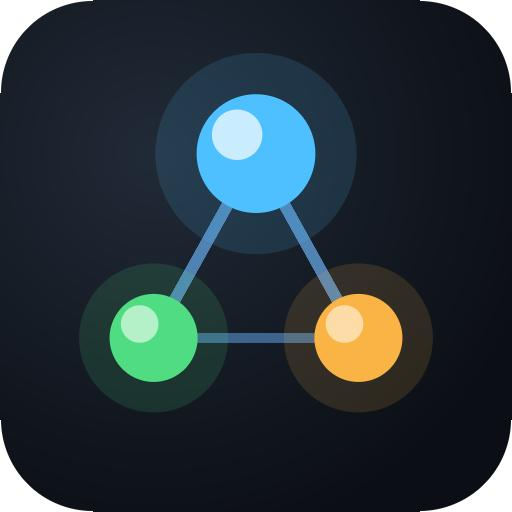

<p align="center">
  
</p>

# ccc-mcp

**讓 ChatGPT Chat 在你的電腦上寫程式、跑測試、完成審查。**

[](https://github.com/bruce601080102/ccc-mcp/actions/workflows/release.yaml)
[](https://www.python.org/downloads/)
[](docs/ch/1-install-and-sign-in.md)
[](https://modelcontextprotocol.io/)
[](LICENSE)

[](docs/ch/2-connect-chatgpt.md)
[](docs/ch/4-workflow.md)
[](docs/ch/4-workflow.md)

ccc-mcp 透過 MCP，把 ChatGPT Chat 接上你電腦上的開發環境，讓它能在**已授權的本機專案**工作。核心想法是：**不要只聽 AI 說程式沒問題，而是留下本機證據。**測試由主機執行、不由 Agent 自己回報；每一次 diff、測試結果與審查都會保存並可接續，這些是單純的聊天視窗做不到的事。額外好處是：它直接用你現有的 ChatGPT 方案運作，不必另外申請按 token 計費的模型 API。**主要用法是 ChatGPT-only**；Codex 與 Claude Code 是選用的協作工具。

> [English README](README.md) · [繁體中文文件](docs/ch/1-install-and-sign-in.md)

## 觀看 Demo

**1080p 高清 · 每秒 60 格 · 有聲音。** 為符合 GitHub 的影片附件大小限制，README 將 Demo 分成三段播放；也可[觀看或下載不中斷的 56 秒高清完整版](docs/assets/demo.mp4)。

**ChatGPT 處理 Astropy 並展示測試結果（0:40–0:56）**

https://github.com/user-attachments/assets/cf288955-585b-43bb-9a0b-275194ac13c4

<details>
<summary>從頭觀看：UI 與專案（0:00–0:20）</summary>

https://github.com/user-attachments/assets/86165f18-3e9c-4ed0-8010-766f263f933b

</details>

<details>
<summary>任務、設定、Skills 與 MCP（0:20–0:40）</summary>

https://github.com/user-attachments/assets/36ea8738-c4c9-4562-b2f2-38b18838e6d7

</details>

[Google Drive 也保留原始錄影](https://drive.google.com/drive/folders/15vn8wYrZ55JL5Aetb1IR6YGm7fK1i81m)；[SWE-bench 證據](#實際成果三題選定的-swe-bench-verified-案例)則另外記錄官方 harness 的結果。

想自己操作？下方的快速開始會帶你從 `ccc-mcp ui` 連上 ChatGPT，並讓它處理已授權的本機專案。

## 從 UI 開始

安裝後直接開啟本機控制中心：

```bash
pip install ccc-mcp
ccc-mcp ui
```

需要 Git 與 Python 3.11 以上。接著在介面裡：

1. **所有專案：**建立專案或加入既有資料夾，再授權該專案寫入。
2. **連線：**依[連接 ChatGPT](docs/ch/2-connect-chatgpt.md)建立 OpenAI Platform Tunnel，在控制台輸入 Tunnel ID 與 runtime API key。
3. **設定：**選擇 `chatgpt-only` profile。**測試指令**可以留空：ccc-mcp 會安裝專案宣告的 Python 相依套件，並在可能時依本次修改的測試檔選擇測試。需要指定測試範圍時再填指令。
4. **ChatGPT：**選取 ccc-mcp 連線，直接提出修改需求；回到 UI 的**任務**與**脈絡**查看實際變更、測試結果和下一步。

UI 只在本機 `127.0.0.1` 提供服務，按 Ctrl+C 停止。[查看控制台所有頁面](#web-控制台)。

**關於 token 與金鑰：**此工作流使用你現有的 ChatGPT 方案，無須另外申請 OpenAI *模型* API 金鑰，也不產生模型 API 的逐 token 計費；[ChatGPT 方案本身仍有使用限制](https://learn.chatgpt.com/docs/pricing)。ccc-mcp 並不宣稱比單一 Agent 更省 token：`SA → SD/RD → REVIEW` 流程多了幾輪，換來的是可驗證性；每個任務的 token 比較仍在量測中。Tunnel 連線會使用獨立的 runtime API key，詳見[連線設定](docs/ch/2-connect-chatgpt.md)。

## 特色一覽

| 能力 | 你可以做什麼 |
| --- | --- |
| **證據，不是口頭回報** | 由主機安裝宣告的相依套件並自行執行 pytest；Agent 說「測試通過」不算數。每一輪都保存主機回傳的結果、可取得的 exit code、diff、報告與審查證據。 |
| **ChatGPT Chat 寫本機程式** | 在對話中讓 ChatGPT 讀取、修改已授權專案，接著執行測試；`chatgpt-only` 不需要安裝 Codex 或 Claude Code。 |
| **可接續的工作流** | 以 `SA → SD/RD → REVIEW` 處理任務，保存版本化共用 Context 與執行紀錄；在另一個聊天室從專案內的 `.ccc-mcp` 資料接續。 |
| **任務對話與控制** | 以有證據的對話閱讀每個任務；在本機介面暫停、繼續、停止或留下修正意見，並透過保存的交接資訊告知 ChatGPT 與下一個 Agent。 |
| **可追溯的執行評估** | 選用評估引擎會將主機測試、diff 與靜態檢查整理成逐次評估報告；品質分數同時顯示證據覆蓋率，缺資料不會假裝成滿分。可在任務頁評估、檢查來源並保留重新評估版本。 |
| **Skills，包含 MCP 型 Skill** | 安裝可重複使用的 `SKILL.md` 工作指引，支援多層目錄的補充檔案；在 UI 選擇全域 Skills，提供所有專案及角色使用。Skill 可引導 Agent 呼叫已另外安裝的 MCP 工具。 |
| **MCP Server 與工具** | 探索本機 MCP Server，為專案安裝並勾選允許使用的工具，再由 ChatGPT 呼叫。例如使用 `codebase-memory-mcp` 分析程式架構與關聯。Skill 提供工作方法，MCP 工具提供即時能力。 |
| **一個本機控制中心** | 用 `ccc-mcp ui` 管理專案、權限、連線、全域 Skills、各專案 MCP 工具、任務及脈絡；CLI 仍可供腳本與進階操作使用。 |

## 評分是怎麼算的

評估引擎（預設關閉，選用）對已完成的 SA/SD/RD/REVIEW 執行評分，依據的全是已經保存下來的證據——host 實際跑出的測試結果、這次執行的 diff、`ruff` 靜態檢查——**不會額外呼叫 LLM，也不花任何 token**。它不會問 Agent「你自己覺得有沒有過」，也不會把另一個 Agent 的附和當成程式碼正確的證明。

刻意分開回報兩個數字：

- **`quality_score`（品質分數）**：只對「真的有證據支撐」的子項目取加權平均，權重依角色設定（測試／需求對照／靜態檢查／安全規則／審查——可在網頁控制台的設定頁逐項調整，也有一鍵套用的快選預設）。
- **`evidence_coverage`（證據覆蓋率）**：這些有證據的子項目，佔該角色總權重的比例。品質分數 100、覆蓋率 70% 的意思是「能查的部分都很完美，但這個角色平常會被看的項目裡只查得到 70%」——不是「100% 有把握」。

`task_status`（任務狀態）另外由一組固定的硬規則判斷，不受加權分數左右：驗收測試沒過、或測試根本沒跑過，不管加權分數多高都不會判成 `PASSED`。另外有一個 Beta-Bernoulli 可靠度追蹤器（`ccc-mcp reputation`），跨所有專案統計每個 Agent／模型／角色／任務類型的可靠度，樣本數不夠時會老實顯示不確定範圍，不會用太少的資料硬算出一個自信的數字。

完整公式與資料模型見[技術參考](docs/ch/10-technical-reference.md#評估引擎)。

## 實際成果：三題選定的 SWE-bench Verified 案例

只使用 **ChatGPT-only**，ccc-mcp 經過多輪修復，解出三題選定的 [SWE-bench Verified](https://www.swebench.com/) Astropy 題目。各題在本機執行官方評測 harness，報告均顯示 `resolved: true`：

| 題目 | Harness 報告 |
| --- | --- |
| `astropy__astropy-12907` | [report.json](benchmarks/swebench-verified/12907-report.json) |
| `astropy__astropy-13236` | [report.json](benchmarks/swebench-verified/13236-report.json) |
| `astropy__astropy-13398` | [report.json](benchmarks/swebench-verified/13398-report.json) |

[查看完整證據與方法](benchmarks/swebench-verified/README.md)，包含評測 run ID 與 ChatGPT 開發對話。這是**三題選定案例**，不是完整 Benchmark 分數，也不是官方排行榜提交結果。

## 以 ChatGPT 為主，其他 Agent 選用

選擇 `chatgpt-only` profile 後，由 ChatGPT 擔任專案管理者，並完成 `SA → SD/RD → REVIEW`。每次交接都保存紀錄，方便在新聊天室讀取既有狀態繼續工作。

```text
ChatGPT Chat → 本機專案 → 測試、diff、審查
       ↑                           │
       └──── 保存的 Context 與下一步 ────┘
```

想用多 Agent 時，才透過原生 CLI 把支援的角色分配給 Codex 或 Claude Code。你可以在**設定**調整 provider、effort、額度 fallback、測試指令與報告語言；詳見[協作工作流程](docs/ch/4-workflow.md)。

## Web 控制台

```bash
ccc-mcp ui
```

在同一個供應 CLI 與 MCP server 的程序裡啟動本機 Web 控制台——不需要另外 clone、建置或啟動前端，即使從原始碼建置也不需要 Node.js（介面是打包進 `ccc-mcp` wheel 的純 HTML/CSS/JS）。只綁定 `127.0.0.1`，啟動後會印出網址並自動開啟瀏覽器；可用 `--port` 指定埠號（若被占用會清楚回報），省略則自動挑一個可用的；`--no-browser` 可停用自動開啟瀏覽器。按 Ctrl+C 即可停止。它讀取與 CLI、MCP server 相同的 `--home` 資料庫，三者的專案與任務資料永遠同步。

控制台的主要頁面：

| 頁面 | 可做的事 |
| --- | --- |
| **工作戰情中心** | 查看任務趨勢、卡點、各專案工作量與 Agent 評估紀錄。可按 5 分鐘至 1 個月篩選此工作空間的 CLI Token 用量；Codex 方案視窗顯示剩餘百分比與重置時間。可在 UI 啟用 Claude 額度同步並按「立即檢查」：ccc-mcp 會在背景短暫開啟 Claude Code（一則極小的 Haiku 訊息、不需要開終端機），顯示官方 5 小時與 7 天剩餘百分比。開啟頁面時每 5 分鐘檢查本機資料。帳戶歷史 Token 總量另列，無法歸因到個別 Chat、Codex 執行或 ccc-mcp 專案。 |
| **所有專案** | 建立專案、加入既有資料夾、整理群組，並管理寫入授權。 |
| **設定** | 調整 profile、provider／角色、報告語言、測試命令與 Meeting Mode。 |
| **任務／脈絡** | 查看階段、等待原因、執行紀錄、usage／CLI 呼叫證據、原始結果與共用 Context。 |
| **連線** | 使用 OpenAI Platform Tunnel 的 ID 與 runtime API key 連到 ChatGPT，查看連線狀態與 log。 |
| **全域 Skills** | 勾選要安裝給所有專案及角色的本機 Claude Code／Codex Skills，並查看或移除已安裝項目。 |

Claude 額度同步須自行啟用：開啟**工作戰情中心 → 用量與剩餘額度 → 啟用 Claude 額度同步**。它會在 Claude Code 使用者層級的 `statusLine` 設定加上本機擷取程式；若原本有狀態列，會保留並照常執行。用量快照只含額度百分比、重置時間與觀測時間；另存原狀態列設定供停用時還原，不讀取 Claude 登入憑證或對話。開啟互動式 Claude Code 並收到一次回覆後，Claude 才會提供額度欄位。戰情中心每 5 分鐘檢查本機快照，標示過時觀測並隱藏已重置的視窗。按**停用 Claude 額度同步**會還原原設定並刪除快照；同步本身不會呼叫模型。詳見 [Anthropic 狀態列欄位文件](https://code.claude.com/docs/en/statusline)。
| **Skills 與 MCP** | 查看共用 Skills；替單一專案探索、安裝及管理本機 stdio MCP server 與其可用工具。 |
| **文件** | 在控制台內閱讀隨套件安裝的繁中與英文指南。 |

在 **Skills 與 MCP** 頁可檢查工具、勾選此專案允許使用的工具、以 JSON 參數呼叫已授權工具，並查看最近的 MCP 呼叫紀錄。全域安裝的 MCP server 也會顯示於此，但仍須用 CLI 移除。側邊欄可切換介面語言，這項瀏覽器偏好與專案報告語言分開。**連線**頁可選擇將金鑰記住在這台裝置上（`~/.ccc-mcp/tunnel/credentials.json`，只開放本機帳號讀取）；金鑰儲存後不會再回傳給瀏覽器。啟用寫入、清除歷史和刪除等操作都需要輸入確認文字；詳見[可靠性與安全邊界](docs/ch/7-reliability-and-security.md#web-控制台)。

**所有專案**頁可建立自訂群組，透過下拉選單或拖放移動專案卡片，並調整群組順序；分類只儲存在本機 `<home>/ui/project_groups.json`，不更動專案路徑或設定。**連線**頁可儲存多筆具名稱的設定，同一 Tunnel ID 也能存不同金鑰；選取設定後按「連線」即可切換，但同時間只執行一組 Tunnel 連線。

## CLI：自動化與進階操作

偏好終端機或要寫腳本時，可用 CLI 操作同一份專案資料。只有要使用 Codex／Claude Code 這類**選用**的原生角色時，才需要先執行 `ccc-mcp setup all` 並完成各自的登入。例如，從頭以 CLI 建立專案：

```bash
ccc-mcp project create hello-demo --write
ccc-mcp --project hello-demo task status
ccc-mcp --project hello-demo task usage
ccc-mcp --project hello-demo context show
```

`--write` 會在建立專案時要求本機確認，授予 ccc-mcp 持續寫入專案並執行設定的測試命令的權限。加入既有資料夾也可用 `ccc-mcp project add <資料夾> --write`。若只用 ChatGPT，可略過 `setup all`，並在專案 **設定**選 `chatgpt-only`，或執行 `ccc-mcp --project hello-demo config profile chatgpt-only`。

對原生角色而言，`task usage` 是確認 CLI 是否真的被呼叫的依據。ChatGPT 角色是互動式執行，`task usage` 會標示 `"interactive": true` 與 `invocation.source: "chatgpt_web"`，其 `cli_invoked: false` 是預期結果。[CLI 參考](docs/ch/8-cli-reference.md)列出完整命令。

## 文件

完整設定建議依序閱讀編號文件；英文與繁中的檔名和順序一致。

| 步驟 | 主題 |
| --- | --- |
| 1 | 安裝與登入 |
| 2 | 連接 ChatGPT |
| 3 | 建立並授權第一個專案 |
| 4 | 執行與恢復工作流程 |
| 5 | 設定 provider、角色、Context 與測試 |
| 6 | 安裝與使用 Skill |
| 7 | 了解可靠性與安全邊界 |
| 8–11 | CLI 參考、公開協議、技術參考與架構 |

- [繁體中文文件目錄](docs/ch/README.md)
- [English README](README.md)
- [English documentation index](docs/en/README.md)

## 重要邊界

持續寫入授權——不論是透過 `project authorize`、`project add --write`／`project create --write`，或 Web 控制台的「啟用寫入」——都允許 ccc-mcp 修改該專案並執行設定的測試命令。相依套件安裝可能執行 package script，因此相依變更也必須納入 diff 審閱。Codex 依設定的 sandbox 執行；Claude Code 雖有限制工具政策，但尚未有同等的 OS 強制 sandbox，應以最低權限的 OS 帳戶執行。

只想從 `project list` 移除專案？執行 `ccc-mcp project remove <id>`，預設保留原資料夾並清除 ccc-mcp 紀錄；相同 ID 重新註冊後會從空白紀錄開始。加上 `--delete-files` 才會連資料夾一起刪除；加上 `--keep-records` 才會封存舊紀錄。Web 控制台的兩種移除方式也都有「保留紀錄」勾選項。兩種資料夾處理方式會要求不同的確認文字，執行中的 Agent 任務必須先結束或取消。`project delete` 是另一種操作：永久註銷 ID、保留原資料夾及歷史證據，不可重用。完整說明見[可靠性與安全邊界](docs/ch/7-reliability-and-security.md)。

## 開發

```bash
python3.11 -m pytest -q
```

本專案要求 Python 3.11 以上。真實 agent 測試需要本機已安裝且登入的 CLI，預設不會執行；詳見[安裝與登入](docs/ch/1-install-and-sign-in.md)。
