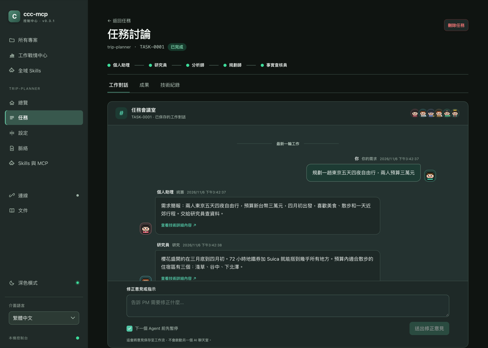
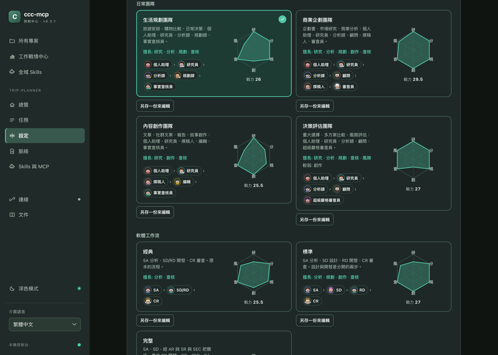
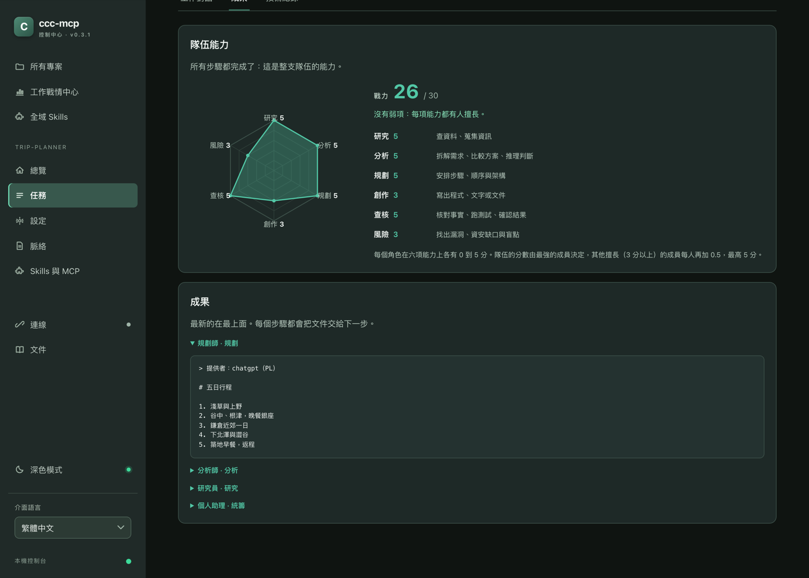
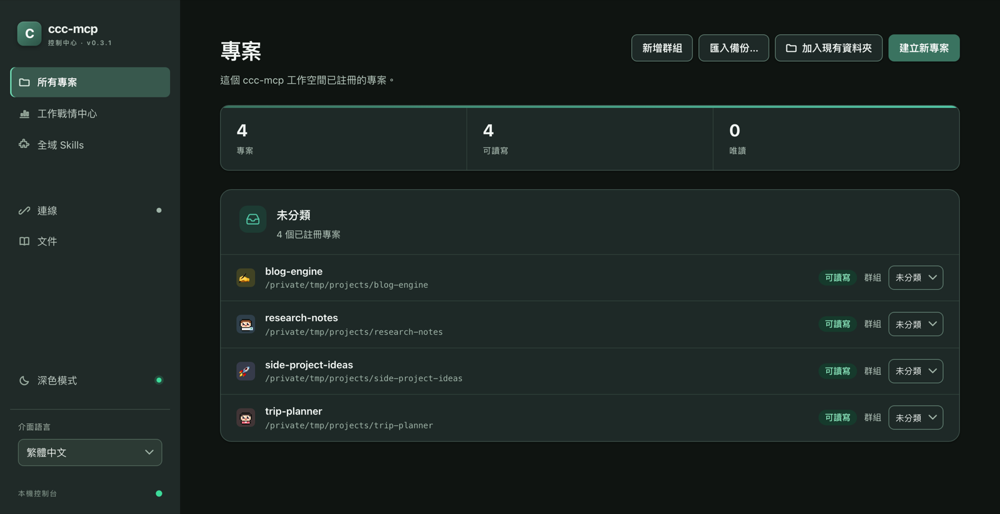

<p align="center">
  
</p>

# ccc-mcp

[](https://github.com/bruce601080102/ccc-mcp/actions/workflows/ci.yaml)
[](https://www.python.org/downloads/)
[](docs/ch/1-install-and-sign-in.md)
[](https://modelcontextprotocol.io/)
[](LICENSE)

[](docs/ch/2-connect-chatgpt.md)
[](docs/ch/4-workflow.md)
[](docs/ch/4-workflow.md)

**換 AI，不必重新開始。**

你在任務做到一半時換 AI，通常得從頭來：得重新解釋哪些已經決定、哪些已經能動、還缺什麼，以及測試到底跑出什麼結果。新的 AI 還是可能在某處猜錯。

**ccc-mcp 把這些狀態保存在你的專案裡，並從中產生交接 Prompt。** Prompt 來自已保存的任務、已核准的計畫、共用 Context、即時 Git 狀態，以及主機實際跑出的測試。下一個 AI 從已記錄的事實開始，而不是從你的摘要開始。

**為什麼不自己複製摘要？** 你的摘要只與你記得的一樣完整。產生的交接會把主機驗證過的結果與 Agent 自述分開，也會列出換手後必須保留的未提交修改。

**真實證據。** 在一次已記錄的測試中，Claude Code 實作 `slugify`，新的 Codex 對話接續該交接，實作 `count_words`。使用者在本機執行的 pytest 通過（2 passed），它不是 ccc-mcp 的主機 TEST-RESULT。這次測試的條件與限制見[真實的跨對話測試](#真實的跨對話測試)。

**現在怎麼試。**

- 已發行版本（PyPI 0.3.2）：`pip install ccc-mcp`，再執行 `ccc-mcp ui`。0.3.2 還沒有 `task continue` 指令。
- 交接指令（開發預覽，從 `main` 安裝）：依照[安裝與發行狀態](#安裝與發行狀態)的步驟從原始碼安裝。

```bash
ccc-mcp --project my-project task continue --target codex
```

只用 ChatGPT 就能完整使用。它使用你現有的 ChatGPT 方案，不另外計費模型 API，因此不需要第二個 AI 訂閱。Claude Code 與 Codex CLI 為選用。

> [English README](README.md) · [繁體中文文件](docs/ch/1-install-and-sign-in.md)

## 真實的跨對話測試

這是在一個小型 Python 專案 `continuity-session-test` 上的一次已記錄測試。兩個 AI 對話都在同一個專案中工作。

| 步驟 | 發生了什麼 |
| --- | --- |
| 1. Claude Code（對話 A） | 實作 `slugify`，`slugify` 的測試通過。`count_words` 仍保留 `NotImplementedError`。 |
| 2. 交接 | 執行 `ccc-mcp --project <id> task continue --target codex`，產生接續 Prompt。 |
| 3. Codex（新對話 B） | 讀取 Prompt、共用 Context 與專案。在使用者明確授權第二階段後，實作 `count_words`，並保留 Claude 對 `slugify` 的修改。 |
| 4. 本機檢查 | 使用者執行 `python -m pytest -q`：**2 passed**。`git diff --check` 通過。沒有修改既有測試。沒有自行 commit 或 push。 |

**怎麼讀這次測試**

- 同一個專案、兩個獨立的 AI 對話。對話 B 沒有繼承對話 A 的聊天記錄。
- 交接來自產生的接續 Prompt，加上 ccc-mcp 的共用 Context。
- 第二階段只在使用者明確授權後才進行。
- `2 passed` 是使用者在本機執行的 pytest。它不是 ccc-mcp 正式的主機 TEST-RESULT，ccc-mcp 自己的 PM 關卡也沒有自動完成。

**這沒有說明什麼：** 不代表每個專案或每次切換都會這樣順利，不代表新的 AI 記得前一個對話，也不代表 token 或時間因此減少。

## 交接如何運作

ccc-mcp 是一個本機的 MCP server 與命令列工具，把 ChatGPT Chat、Claude Code 或 Codex CLI 接到**已授權的專案**。它遵循一個原則：不要聽 AI 說程式沒問題。測試由主機執行，每一次 diff、測試結果與審查都保存在專案的 `.ccc-mcp` 資料中，因此任務可以在另一個對話接續。**ChatGPT-only 是主要用法。** Codex 與 Claude Code 是選用的協作工具，適合想把角色分配到不同工具的團隊。

共用 Context 與已核准的計畫是事實來源，Prompt 只是把它們帶給下一個 AI。它包含：

- **任務與計畫：** 需求、驗收條件，以及已核准計畫的編號、版本、hash 與本文。若沒有核准的計畫，或最新計畫只是未核准的草稿，Prompt 會直接寫明，不會把草稿當成指令。
- **Agent 自述與主機證據分開：** 每個 Agent 的回報都標示為它自己的說法；主機實際跑出的測試結果則標示為主機證據。主機尚未驗證的項目標示為未完成。
- **剩餘工作：** 由任務狀態推導。若 ccc-mcp 無法判斷還剩什麼，Prompt 會寫「待確認」，並指出該查看的檔案。
- **即時 Git 狀態：** `git status` 與 diff 摘要，並提醒不得破壞既有的未提交修改。
- **來源路徑：** 下一個 AI 可以回頭核對每一點的原始檔案。

使用 `--target claude`、`--target codex` 或 `--target chatgpt`，可以指定 Prompt 交給哪一個 AI；省略則輸出一般的交接報告。

產生 Prompt 不代表下一個 AI 已經接手。新的對話仍然必須讀取 Prompt、在同一個專案裡工作，並通過主機的測試。

## 與另一個 AI 接續工作

有三種不同的機制，請分開看待，留意狀態欄。

| 機制 | 運作方式 | 狀態 |
| --- | --- | --- |
| **Prompt 優先的手動交接** | 執行 `task continue --target`，再把 Prompt 貼進新的對話。不會替你自動切換。 | 開發預覽：在 `main` 上，尚未收錄於 PyPI 0.3.2 |
| **共用 Context 與 MCP 協助接續** | 新的 ChatGPT 對話透過 ccc-mcp 的 MCP 工具，讀取專案 `.ccc-mcp` 資料中保存的任務狀態。 | 已在發行版本中 |
| **額度備援（Quota fallback）** | 當某個角色的 provider 回報額度用盡，ccc-mcp 可以把同一個任務重新派工給你用 `--quota-fallback` 設定的備援 provider。派工不等於完成：備援可能停在 `CHATGPT_HANDOFF_PENDING`，等待有人接手。 | 已在發行版本中 |

**目前尚未支援：**

- 一鍵或完全自動的 provider 切換。
- 轉移 Claude 或 Codex 內部的對話記憶。只會轉移已記錄的任務狀態。
- 在沒有共用專案的情況下接續。下一個 AI 需要能存取同一個專案，以及任務所涉及的檔案。
- 切換正在執行中的 Agent。沒有即時搶占。
- 跳過核准。計畫在專案要求核准的情況下仍需要核准。
- 證明 token 較少，或 Benchmark 成績更好。

## 安裝與發行狀態

`main` 分支已經領先最近一次的 PyPI 發行版本。依照本 README 的指令操作前，請先確認你使用的是哪一個版本。

| 功能 | PyPI 0.3.2（`pip install ccc-mcp`） | `main`（原始碼） |
| --- | --- | --- |
| 共用 Context、任務紀錄、主機執行的測試 | 有 | 有 |
| 額度備援（`--quota-fallback`） | 有 | 有 |
| `task continue --target` 接續 Prompt | 沒有 | 開發預覽 |
| 控制台任務頁的交接面板（技術紀錄） | 沒有 | 尚未收錄於 `main` |

**已發行版本：**

```bash
pip install ccc-mcp
ccc-mcp ui
```

**開發預覽（交接指令）：** 已提交到 `main` 並推送，但尚未發行。請從原始碼安裝：

```bash
git clone https://github.com/bruce601080102/ccc-mcp.git
cd ccc-mcp
pip install -e .
ccc-mcp --project <id> task continue --target codex
```

原始碼安裝在下次發行前仍會顯示版本 0.3.1。若 `ccc-mcp --project <id> task continue --help` 出現查無此指令的訊息，代表你使用的是已發行版本。

## 更多功能

<p align="center">
  
</p>

### 一間 AI 專家的聊天室
工作就是一場對話。**19 個角色**（分析、設計、開發、程式碼審查、資安審查、研究員、撰稿人、事實查核員…）各有**像素頭像和可以自己取的名字**，任務傳到誰就由誰用自己的口吻回報。隨時可以暫停、停止或留下修正意見，不必再猜現在輪到誰、上一個做了什麼。

### 自己組合的工作流，會把關也會退回
<p align="center">
  
</p>

**7 套內建工作流**（經典、標準、完整，加上四套日常團隊），也能自己組合並儲存。每個任務用哪一套，可以交給 ChatGPT、ccc-mcp 或你決定。**審查關卡**發現問題會退回產出那一步：對抗式審查有「一般／嚴格／極限」三種強度，每個阻擋性的說法都必須附證據，退回次數有上限（1–5）。用完次數就交給你決定，不會讓 Agent 無限循環。

### 不只寫程式
四套現成的**日常團隊**，用同一套機制處理旅行規劃、商業企劃、文章或重大決定：*個人助理 → 研究員 → 分析師 → 規劃師 → 事實查核員*…。它們跑在 ChatGPT 上，所以能上網查資料。**規格寫手**則把討論結論整理成 AI 看得懂、能照著實作的規格書。

### 遊戲風格的能力圖
<p align="center">
  
</p>

每個角色在六項能力上各有 0 到 5 分：**研究、分析、規劃、創作、查核、風險**。每套工作流會顯示合併後的**隊伍能力圖與戰力**，並指出隊上沒人擅長的項目；任務執行時，能力圖還會**隨著步驟完成逐漸長大**。挑隊伍時看它擅長什麼，不用憑感覺。

### 不必乾等的交接
ChatGPT 擔任日常團隊的某一步時，交出報告後下一步立刻開始，角色之間不再多一輪「PM 整理」。任務一樣可以接續，全程用你現有的 ChatGPT 方案。

### 屬於你的本機控制台
<p align="center">
  
</p>

`ccc-mcp ui` 把專案（可**自訂圖示**：像素角色、表情符號或文字，再選顏色）、群組、設定、Context、Skills 與 MCP 工具集中在一處。有淺色與深色主題、繁體中文與英文，手機寬度也能用。

### 暫停、修正與接續

在本機介面以有證據的對話閱讀每個任務；暫停、繼續、停止，或留下修正意見。保存的交接資訊會讓 ChatGPT 與下一個 Agent 都知道目前狀況。

### 可追溯的執行評估

選用的評估引擎會根據已保存的證據（主機測試、diff、靜態檢查）評分已完成的執行。見[評分是怎麼算的](#評分是怎麼算的)。

### Skills 與 MCP 工具

安裝可重複使用的 `SKILL.md` 工作指引，支援多層目錄的補充檔案；在 UI 選擇全域 Skills，讓所有專案與角色都能使用。可探索本機 MCP server，為專案安裝並勾選允許使用的工具，再由 ChatGPT 呼叫。例如 `codebase-memory-mcp` 可以提供程式架構與關聯。Skill 提供工作方法，MCP 工具提供即時能力。

## 觀看 Demo

**1080p 高清 · 每秒 60 格 · 有聲音 · 63 秒。**

https://github.com/user-attachments/assets/eb7512b3-7f67-4a2e-aa7a-9e4b06a9a7d2

[Google Drive 也保留原始錄影](https://drive.google.com/drive/folders/15vn8wYrZ55JL5Aetb1IR6YGm7fK1i81m)；[SWE-bench 證據](#實際成果三題選定的-swe-bench-verified-案例)則另外記錄官方 harness 的結果。

這段影片沒有展示跨對話交接。那次測試見[真實的跨對話測試](#真實的跨對話測試)。

想自己操作？下方的快速開始會帶你從 `ccc-mcp ui` 連上 ChatGPT，並讓它處理已授權的本機專案。

## 從 UI 開始

安裝後直接開啟本機控制中心：

```bash
pip install ccc-mcp
ccc-mcp ui
```

需要 Git 與 Python 3.11 以上。以上是已發行版本的安裝方式；`task continue --target` 交接指令尚未收錄於此版本，要使用時請從原始碼安裝，見[安裝與發行狀態](#安裝與發行狀態)。接著在介面裡：

1. **所有專案：** 建立專案或加入既有資料夾，再授權該專案寫入。
2. **連線：** 依[連接 ChatGPT](docs/ch/2-connect-chatgpt.md)建立 OpenAI Platform Tunnel，在控制台輸入 Tunnel ID 與 runtime API key。
3. **設定：** 選擇 `chatgpt-only` profile。**測試指令**可以留空：ccc-mcp 會安裝專案宣告的 Python 相依套件，並在可能時依本次修改的測試檔選擇測試。需要指定測試範圍時再填指令。
4. **ChatGPT：** 選取 ccc-mcp 連線，直接提出修改需求；回到 UI 的**任務**與**脈絡**查看實際變更、測試結果和下一步。

UI 只在本機 `127.0.0.1` 提供服務，按 Ctrl+C 停止。[查看控制台所有頁面](#web-控制台)。

**關於 token 與金鑰：** 此工作流使用你現有的 ChatGPT 方案，無須另外申請 OpenAI *模型* API 金鑰，也不產生模型 API 的逐 token 計費；[ChatGPT 方案本身仍有使用限制](https://learn.chatgpt.com/docs/pricing)。ccc-mcp 並不宣稱比單一 Agent 更省 token：`SA → SD/RD → REVIEW` 流程多了幾輪，換來的是可驗證性；每個任務的 token 比較仍在量測中。Tunnel 連線會使用獨立的 runtime API key，詳見[連線設定](docs/ch/2-connect-chatgpt.md)。

## 評分是怎麼算的

評估引擎（預設關閉，選用）對已完成的 SA/SD/RD/REVIEW 執行評分，依據的全是已經保存下來的證據——host 實際跑出的測試結果、這次執行的 diff、`ruff` 靜態檢查——**不會額外呼叫 LLM，也不花任何 token**。它不會問 Agent「你自己覺得有沒有過」，也不會把另一個 Agent 的附和當成程式碼正確的證明。

刻意分開回報兩個數字：

- **`quality_score`（品質分數）**：只對「真的有證據支撐」的子項目取加權平均，權重依角色設定（測試／需求對照／靜態檢查／安全規則／審查——可在網頁控制台的設定頁逐項調整，也有一鍵套用的快選預設）。
- **`evidence_coverage`（證據覆蓋率）**：這些有證據的子項目，佔該角色總權重的比例。品質分數 100、覆蓋率 70% 的意思是「能查的部分都很完美，但這個角色平常會被看的項目裡只查得到 70%」——不是「100% 有把握」。

`task_status`（任務狀態）另外由一組固定的硬規則判斷，不受加權分數左右：驗收測試沒過、或測試根本沒跑過，不管加權分數多高都不會判成 `PASSED`。另外有一個 Beta-Bernoulli 可靠度追蹤器（`ccc-mcp reputation`），跨所有專案統計每個 Agent／模型／角色／任務類型的可靠度，樣本數不夠時會老實顯示不確定範圍，不會用太少的資料硬算出一個自信的數字。

完整公式與資料模型見[技術參考](docs/ch/10-technical-reference.md#評估引擎)。

## 實際成果：三題選定的 SWE-bench Verified 案例

只使用 **ChatGPT-only**，ccc-mcp 經過多輪修復，解出三題選定的 [SWE-bench Verified](https://www.swebench.com/) Astropy 題目。各題在本機執行官方評測 harness，報告均顯示 `resolved: true`：

| 題目 | Harness 報告 |
| --- | --- |
| `astropy__astropy-12907` | [report.json](benchmarks/swebench-verified/12907-report.json) |
| `astropy__astropy-13236` | [report.json](benchmarks/swebench-verified/13236-report.json) |
| `astropy__astropy-13398` | [report.json](benchmarks/swebench-verified/13398-report.json) |

[查看完整證據與方法](benchmarks/swebench-verified/README.md)，包含評測 run ID 與 ChatGPT 開發對話。這是**三題選定案例**，不是完整 Benchmark 分數，也不是官方排行榜提交結果。

## 以 ChatGPT 為主，其他 Agent 選用

選擇 `chatgpt-only` profile 後，由 ChatGPT 擔任專案管理者，並完成所選工作流的每個角色。每次交接都保存紀錄，方便在新聊天室讀取既有狀態繼續工作。

在 `chatgpt-only` 模式下，ChatGPT 可以讀取並修改已授權的本機專案，然後在同一個對話中繼續工作。不需要安裝 Codex 或 Claude Code；它使用你現有的 ChatGPT 方案，不另外計費模型 API。

```text
ChatGPT Chat → 本機專案 → 測試、diff、審查
       ↑                           │
       └──── 保存的 Context 與下一步 ────┘
```

想用多 Agent 時，才透過原生 CLI 把支援的角色分配給 Codex 或 Claude Code。你可以在**設定**調整 provider、effort、額度 fallback、測試指令與報告語言；詳見[協作工作流程](docs/ch/4-workflow.md)。

## 未來規劃

> 以下是目標，不是現在能用的功能，也沒有預定的發布日期。

**能自己跑完工作流的 Bot。** 現在由一個 ChatGPT 對話擔任專案經理並推動工作流；Codex 和 Claude Code 可以接手個別角色，但任務仍要由 ChatGPT 對話發起並帶領。

下一個目標是做出類似 Bot 的入口，不再需要開 ChatGPT 對話：直接串接 Codex、Claude 或其他模型，並像現在組合工作流一樣把它們串成一條流程。你已經在用的部分預計原樣沿用：角色流程與關卡、顯示誰說了什麼的聊天室、能力圖，以及以主機實際跑出的測試結果當證據，而不是聽 Agent 自己回報。

## Web 控制台

```bash
ccc-mcp ui
```

在同一個供應 CLI 與 MCP server 的程序裡啟動本機 Web 控制台——不需要另外 clone、建置或啟動前端，即使從原始碼建置也不需要 Node.js（介面是打包進 `ccc-mcp` wheel 的純 HTML/CSS/JS）。只綁定 `127.0.0.1`，啟動後會印出網址並自動開啟瀏覽器；可用 `--port` 指定埠號（若被占用會清楚回報），省略則自動挑一個可用的；`--no-browser` 可停用自動開啟瀏覽器。按 Ctrl+C 即可停止。它讀取與 CLI、MCP server 相同的 `--home` 資料庫，三者的專案與任務資料永遠同步。

控制台的主要頁面：

| 頁面 | 可做的事 |
| --- | --- |
| **工作戰情中心** | 查看任務趨勢、卡點、各專案工作量與 Agent 評估紀錄。可按 5 分鐘至 1 個月篩選此工作空間的 CLI Token 用量；Codex 方案視窗顯示剩餘百分比與重置時間。可在 UI 啟用 Claude 額度同步並按「立即檢查」：ccc-mcp 會在背景短暫開啟 Claude Code（一則極小的 Haiku 訊息、不需要開終端機），顯示官方 5 小時與 7 天剩餘百分比。開啟頁面時每 5 分鐘檢查本機資料。帳戶歷史 Token 總量另列，無法歸因到個別 Chat、Codex 執行或 ccc-mcp 專案。 |
| **所有專案** | 建立專案、加入既有資料夾、整理群組、匯入單一專案備份，並管理寫入授權。專案總覽可匯出設定與工作紀錄。 |
| **設定** | 調整 profile、provider／角色（含頭像、名字與能力圖）、工作流與審查關卡、報告語言、測試命令與 Meeting Mode。 |
| **任務／脈絡** | 查看階段、等待原因、執行紀錄、usage／CLI 呼叫證據、原始結果與共用 Context。 |
| **連線** | 使用 OpenAI Platform Tunnel 的 ID 與 runtime API key 連到 ChatGPT，查看連線狀態與 log。 |
| **全域 Skills** | 勾選要安裝給所有專案及角色的本機 Claude Code／Codex Skills，並查看或移除已安裝項目。 |

Claude 額度同步須自行啟用：開啟**工作戰情中心 → 用量與剩餘額度 → 啟用 Claude 額度同步**。它會在 Claude Code 使用者層級的 `statusLine` 設定加上本機擷取程式；若原本有狀態列，會保留並照常執行。用量快照只含額度百分比、重置時間與觀測時間；另存原狀態列設定供停用時還原，不讀取 Claude 登入憑證或對話。開啟互動式 Claude Code 並收到一次回覆後，Claude 才會提供額度欄位。戰情中心每 5 分鐘檢查本機快照，標示過時觀測並隱藏已重置的視窗。按**停用 Claude 額度同步**會還原原設定並刪除快照；同步本身不會呼叫模型。詳見 [Anthropic 狀態列欄位文件](https://code.claude.com/docs/en/statusline)。
| **Skills 與 MCP** | 查看共用 Skills；替單一專案探索、安裝及管理本機 stdio MCP server 與其可用工具。 |
| **文件** | 在控制台內閱讀隨套件安裝的繁中與英文指南。 |

在 **Skills 與 MCP** 頁可檢查工具、勾選此專案允許使用的工具、以 JSON 參數呼叫已授權工具，並查看最近的 MCP 呼叫紀錄。全域安裝的 MCP server 也會顯示於此，但仍須用 CLI 移除。側邊欄可切換介面語言，這項瀏覽器偏好與專案報告語言分開。**連線**頁可選擇將金鑰記住在這台裝置上（`~/.ccc-mcp/tunnel/credentials.json`，只開放本機帳號讀取）；金鑰儲存後不會再回傳給瀏覽器。啟用寫入、清除歷史和刪除等操作都需要輸入確認文字；詳見[可靠性與安全邊界](docs/ch/7-reliability-and-security.md#10-web-控制台)。

**所有專案**頁可建立自訂群組，透過下拉選單或拖放移動專案卡片，並調整群組順序；分類只儲存在本機 `<home>/ui/project_groups.json`，不更動專案路徑或設定。**連線**頁可儲存多筆具名稱的設定，同一 Tunnel ID 也能存不同金鑰；選取設定後按「連線」即可切換，但同時間只執行一組 Tunnel 連線。

## CLI：自動化與進階操作

偏好終端機或要寫腳本時，可用 CLI 操作同一份專案資料。只有要使用 Codex／Claude Code 這類**選用**的原生角色時，才需要先執行 `ccc-mcp setup all` 並完成各自的登入。例如，從頭以 CLI 建立專案：

```bash
ccc-mcp project create hello-demo --write
ccc-mcp --project hello-demo task status
ccc-mcp --project hello-demo task usage
ccc-mcp --project hello-demo context show
```

`--write` 會在建立專案時要求本機確認，授予 ccc-mcp 持續寫入專案並執行設定的測試命令的權限。加入既有資料夾也可用 `ccc-mcp project add <資料夾> --write`。若只用 ChatGPT，可略過 `setup all`，並在專案 **設定**選 `chatgpt-only`，或執行 `ccc-mcp --project hello-demo config profile chatgpt-only`。

對原生角色而言，`task usage` 是確認 CLI 是否真的被呼叫的依據。ChatGPT 角色是互動式執行，`task usage` 會標示 `"interactive": true` 與 `invocation.source: "chatgpt_web"`，其 `cli_invoked: false` 是預期結果。[CLI 參考](docs/ch/8-cli-reference.md)列出完整命令。

## 文件

完整設定建議依序閱讀編號文件；英文與繁中的檔名和順序一致。

| 步驟 | 主題 |
| --- | --- |
| 1 | 安裝與登入 |
| 2 | 連接 ChatGPT |
| 3 | 建立並授權第一個專案 |
| 4 | 執行與恢復工作流程 |
| 5 | 設定 provider、角色、Context 與測試 |
| 6 | 安裝與使用 Skill |
| 7 | 了解可靠性與安全邊界 |
| 8–11 | CLI 參考、公開協議、技術參考與架構 |

- [繁體中文文件目錄](docs/ch/README.md)
- [English README](README.md)
- [English documentation index](docs/en/README.md)

## 重要邊界

持續寫入授權——不論是透過 `project authorize`、`project add --write`／`project create --write`，或 Web 控制台的「啟用寫入」——都允許 ccc-mcp 修改該專案並執行設定的測試命令。相依套件安裝可能執行 package script，因此相依變更也必須納入 diff 審閱。Codex 依設定的 sandbox 執行；Claude Code 雖有限制工具政策，但尚未有同等的 OS 強制 sandbox，應以最低權限的 OS 帳戶執行。

只想從 `project list` 移除專案？執行 `ccc-mcp project remove <id>`，預設保留原資料夾並清除 ccc-mcp 紀錄；相同 ID 重新註冊後會從空白紀錄開始。加上 `--delete-files` 才會連資料夾一起刪除；加上 `--keep-records` 才會封存舊紀錄。Web 控制台的兩種移除方式也都有「保留紀錄」勾選項。兩種資料夾處理方式會要求不同的確認文字，執行中的 Agent 任務必須先結束或取消。`project delete` 是另一種操作：永久註銷 ID、保留原資料夾及歷史證據，不可重用。完整說明見[可靠性與安全邊界](docs/ch/7-reliability-and-security.md)。

## 開發

```bash
python3.11 -m pytest -q
```

本專案要求 Python 3.11 以上。真實 agent 測試需要本機已安裝且登入的 CLI，預設不會執行；詳見[安裝與登入](docs/ch/1-install-and-sign-in.md)。

## 發版

檢查時間、發版時間和版本號都由你決定。推送或建立 Pull Request 後不會自動執行任何流程。需要檢查時，手動執行 **CI**，它只跑 lint 與 Linux、Windows 的重點測試，不會建置發版套件、修改版本或發布。準備發版時，從 `main` 手動執行 **Release**，在 GitHub 表單輸入版號（例如 `0.3.0`，不用加 `v`）。Release 才會跑完整的 Python 與跨平台測試矩陣、建置及安裝 wheel、核對 wheel 與 sdist，為一致的原始碼建立 tag，再發布到 GitHub Releases 與 PyPI；不會改動 `main` 的版本檔。
